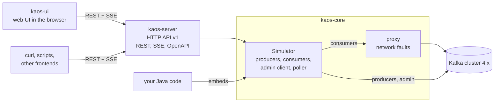

# Contributing to Kaos

## Requirements

- **Java 21** (a JDK).
- **Docker**, for the integration tests, which start a broker with
  Testcontainers.
- **Node** is not needed: the build downloads its own.

## Build and run from source

```sh
docker run -p 9092:9092 apache/kafka:4.4.0   # a local broker
./run.sh                                     # build the jar and run it
```

`./run.sh` builds the shaded jar,
`kaos-server/target/kaos-server-<version>.jar`, and passes all its
arguments to it (`./run.sh --help`). The first build takes a few
minutes, since it also downloads Node and builds the UI. The UI is then
at <http://localhost:8081>.

## Development

The build is Maven, through the wrapper:

```sh
./mvnw verify              # unit tests, integration tests (Docker), format check, UI build and Vitest
./mvnw verify -DskipITs    # without the integration tests
./mvnw verify -DskipUi     # without the frontend build; the jar then serves no UI
./mvnw spotless:apply      # format the Java sources, add the license headers
```

`verify` fails on unformatted Java code or a missing license header, and
`spotless:apply` fixes both. The frontend build installs the Node of
[`kaos-ui/.nvmrc`](kaos-ui/.nvmrc) into `kaos-ui/node`, so nothing needs
to be installed. CI runs `./mvnw verify` on every pull request.

For the UI, run the backend and the Vite dev server side by side:

```sh
./mvnw -pl kaos-server -am -DskipUi compile exec:java   # backend on localhost:8081
cd kaos-ui && npm run dev                                # UI with hot reload; Vite proxies /api
```

The UI is then at <http://localhost:5173>. `npm run dev` works with the
Node installed by the build too:
`PATH="$PWD/node:$PATH" npm run dev` in `kaos-ui`. After a change of
the OpenAPI document, `npm run gen:api` regenerates the TypeScript types
of the UI; the build fails while they differ.

[`CLAUDE.md`](CLAUDE.md) lists the rules of the code base, and
[`docs/ARCHITECTURE.md`](docs/ARCHITECTURE.md) is updated with every
change of the design.

## Architecture



- **`kaos-core`** is the library. A `Simulator` holds topics, producers
  and consumer groups, which can be added and removed at any time, runs
  real Kafka clients, and publishes an immutable snapshot of everything
  on each change. The consumers reach the cluster through a proxy
  ([Kroxylicious](https://kroxylicious.io/)) that applies the network
  faults per consumer.
- **`kaos-server`** is a thin HTTP adapter over one `Simulator` and
  builds the runnable jar.
- **`kaos-ui`** is the React and TypeScript UI, embedded in the jar and
  served at `/`. It only uses the HTTP API.

[`docs/ARCHITECTURE.md`](docs/ARCHITECTURE.md) describes the design in
depth: the threading and failure model, the snapshot pipeline, the proxy
and the frontend.

## Releasing

A release is one manual run of the Release workflow, with no git step:
**Actions → Release → Run workflow** on `main`, or
`gh workflow run release.yml`. The version field is optional: empty, it
releases the version of the POMs without `-SNAPSHOT` (`0.2.0-SNAPSHOT`
releases `0.2.0`).

[`.github/workflows/release.yml`](.github/workflows/release.yml) builds
and tests that version, pushes the image `ghcr.io/dajac/kaos:X.Y.Z`
(also tagged `latest`) for `linux/amd64` and `linux/arm64`,
creates the tag `vX.Y.Z` and the GitHub release with the jar, and
moves `main` to the next minor SNAPSHOT (`0.2.0` puts it on
`0.3.0-SNAPSHOT`). Every night,
[`.github/workflows/nightly.yml`](.github/workflows/nightly.yml)
pushes the image of `main` as `nightly` and `nightly-YYYYMMDD`.

The image is the [`Dockerfile`](Dockerfile) of the root, built from
the jar:

```sh
./mvnw clean package -DskipTests -DskipITs
docker build -t kaos .
docker run --rm -p 8081:8081 kaos --bootstrap-server host:9092
```
