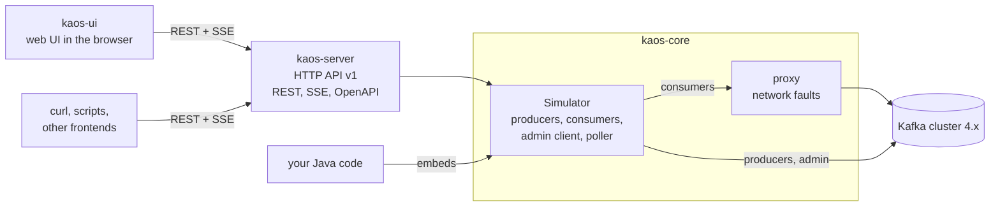

# Kaos

Kaos is an interactive simulator of Kafka consumer groups, built for the
new consumer rebalance protocol of
[KIP-848](https://cwiki.apache.org/confluence/display/KAFKA/KIP-848%3A+The+Next+Generation+of+the+Consumer+Rebalance+Protocol).
It runs real Kafka consumers and producers against your cluster, lets you
disturb them (stop a consumer, freeze it, cut it off the network, upgrade
or downgrade its protocol), and shows live how the group rebalances,
which partitions each consumer owns, receives or gives up, and how the
lag evolves. Groups can mix consumers of the `consumer` and `classic`
protocols, with any assignor. Kaos ships as one runnable jar with a web
UI, a versioned HTTP API and an embeddable Java library.


*A group of five consumers on two topics: `consumer-1` is cut off the
network, `consumer-3` is frozen and does not take the partitions (in
blue) that the coordinator moved to it, `consumer-4` speaks the classic
protocol.*

- [Requirements](#requirements)
- [Quickstart](#quickstart)
- [Architecture](#architecture)
- [Java API](#java-api)
- [HTTP API](#http-api)
- [Development](#development)
- [Known behaviours](#known-behaviours)
- [License](#license)

## Requirements

- **Java 21** (a JDK), to build and to run.
- **A Kafka broker 4.x** with the KIP-848 consumer protocol enabled. It
  is on by default from Kafka 4.0 (`group.coordinator.rebalance.protocols`
  includes `consumer`).
- **Reachable advertised listeners.** Kaos connects its admin client and
  its producers straight to the brokers, and its consumers through a
  proxy that forwards to the brokers, so the addresses the brokers
  advertise must be reachable from where Kaos runs, not only the
  bootstrap address.
- **Docker**, only for the integration tests of the build, which start a
  broker with Testcontainers.
- **Node** is not needed: the build downloads its own (see
  [Development](#development)).

## Quickstart

1. Start a broker:

   ```sh
   docker run -p 9092:9092 apache/kafka:4.4.0
   ```

2. Build and start Kaos. The first build takes a few minutes, since it
   also downloads Node and builds the UI.

   ```sh
   ./run.sh
   ```

   All the options go to the application:

   ```text
   $ ./run.sh --help
   Usage: kaos [-hV] [--bootstrap-server=<host:port>] [--port=<port>]
               [--proxy-port=<port>]
   Interactive Kafka consumer group (KIP-848) simulator.
         --bootstrap-server=<host:port>
                               Kafka bootstrap servers (default: localhost:9092)
         --port=<port>         HTTP port; 0 picks a free port (default: 8081)
         --proxy-port=<port>   First port the proxy tries; it moves up when busy
                                 (default: 19092)
     -h, --help                Show this help message and exit.
     -V, --version             Print version information and exit.
   ```

   The runnable jar is `kaos-server/target/kaos-server-<version>.jar`,
   and `java -jar` runs it with the same options.

3. Open <http://localhost:8081>.

4. Run a first simulation. The panel on the left describes one group:
   its id, its protocol and assignor, its topics and partitions, and its
   consumers, each of which can override the settings of the group.
   Keep the defaults (three consumers of the `consumer` protocol on one
   topic of 36 partitions) and press **Start**. Kaos creates the topic,
   starts a producer and the consumers, and shows one row per consumer
   with the partitions it owns. Then, from the **Actions** menu of a
   consumer, try **Partition network**, **Freeze consumer** or
   **Downgrade to classic**, and watch the group react. **Stop** deletes
   the topics and the group.

## Architecture



- **`kaos-core`** is the library. A `Simulator` holds topics, producers
  and consumer groups, which can be added and removed at any time, runs
  real Kafka clients, and publishes an immutable snapshot of everything
  on each change. The consumers reach the cluster through a proxy
  ([Kroxylicious](https://kroxylicious.io/)) that applies the network
  faults per consumer.
- **`kaos-server`** is a thin HTTP adapter over one `Simulator` and
  builds the runnable jar.
- **`kaos-ui`** is the React and TypeScript UI, embedded in the jar and
  served at `/`. It only uses the HTTP API.

[`docs/ARCHITECTURE.md`](docs/ARCHITECTURE.md) describes the design in
depth: the threading and failure model, the snapshot pipeline, the proxy
and the frontend.

## Java API

`kaos-core` has a fluent API in the package `io.github.dajac.kaos`: build
a `Simulator`, add topics, producers and groups, `start()` it, and drive
the consumers through their handles. `close()` removes everything it
created on the cluster.

```java
try (var simulator = new Simulator("localhost:9092")) {
    Topic orders = simulator.addTopic("orders", 12);
    simulator.addProducer(p -> p.topics(orders).ratePerPartition(2));

    ConsumerGroup group = simulator.addGroup("orders-app", g -> g
        .subscribe(orders)
        .consumerDefaults(c -> c.protocol(Protocol.CONSUMER).assignor("uniform"))
        .consumers(3) // consumer-0..2 inherit the defaults
        .consumer(c -> c.protocol(Protocol.CLASSIC).assignor("range"))); // consumer-3 overrides them

    simulator.start(); // creates the topics, starts the proxy, the producer and the consumers

    // Wait until every consumer is a stable member of the group.
    group.awaitSnapshot(
        s -> s.consumers().stream().allMatch(c -> c.status() == ConsumerStatus.STABLE),
        Duration.ofMinutes(1));

    // Cut consumer-0 off the network: the proxy drops its requests until the fault is cleared.
    ConsumerHandle c0 = group.consumer(0);
    c0.inject(Fault.networkIsolation());
    group.awaitSnapshot(s -> s.consumers().get(0).partitions().isEmpty(), Duration.ofMinutes(2));
    c0.clear(Fault.networkIsolation());

    // Upgrade consumer-3 to the consumer protocol while the group runs.
    group.consumer(3).switchProtocol(Protocol.CONSUMER);

    GroupSnapshot snapshot = group.snapshot();
    System.out.println(snapshot.state() + " at epoch " + snapshot.epoch() + ", lag " + snapshot.lag());
} // close() stops everything and deletes the topics and the group
```

The example is compiled by the build:
[`ReadmeExampleTest`](kaos-core/src/test/java/io/github/dajac/kaos/ReadmeExampleTest.java)
holds the same code and fails when the two differ, so a change of one
goes with a change of the other.

The other faults are `Fault.freeze()` (the consumer stops polling) and
`Fault.connectionReset()` (the proxy closes its connections). Consumers
also `leave()` and `join()` the group; producers `pause()` and
`resume()`; and listeners
(`withListener`, `addListener`) receive every new snapshot. Kaos is not
published to a Maven repository yet: `./mvnw -pl kaos-core -am install
-DskipTests -DskipITs` installs `io.github.dajac:kaos-core:0.1.0-SNAPSHOT`
in the local Maven repository.

## HTTP API

The server exposes the same model as a versioned, resource-oriented HTTP
API under `/api/v1`: REST to change the simulation, Server-Sent Events
to follow it, and [RFC 9457](https://www.rfc-editor.org/rfc/rfc9457)
problem details for errors. A running server describes it as an
OpenAPI 3.1 document at
[`/api/v1/openapi.yaml`](http://localhost:8081/api/v1/openapi.yaml); the
source is
[`kaos-server/src/main/resources/openapi/kaos-v1.yaml`](kaos-server/src/main/resources/openapi/kaos-v1.yaml).

Start a simulation with one topic, one producer and a group of three
consumers, one of which speaks the classic protocol:

```sh
curl -X POST localhost:8081/api/v1/simulator \
  -H 'Content-Type: application/json' \
  -d '{
        "topics": [{"name": "orders", "partitions": 12}],
        "producers": [{"topics": ["orders"]}],
        "groups": [{"id": "orders-app", "subscribedTopics": ["orders"],
                    "consumers": [{}, {}, {"overrides": {"protocol": "classic"}}]}]
      }'
```

Follow it: the stream sends the current `status` and `snapshot` on
connect, then each change.

```sh
curl -N localhost:8081/api/v1/simulator/events
```

Freeze a consumer, clear the fault, and stop the simulation:

```sh
curl -X PUT    localhost:8081/api/v1/simulator/groups/orders-app/consumers/consumer-0/faults/freeze
curl -X DELETE localhost:8081/api/v1/simulator/groups/orders-app/consumers/consumer-0/faults/freeze
curl -X DELETE localhost:8081/api/v1/simulator
```

`GET /api/v1/meta` returns the defaults, ranges, assignors and faults,
and `GET /api/v1/simulator/snapshot` the current snapshot.
[`kaos-server/src/test/scripts/curl-session.sh`](kaos-server/src/test/scripts/curl-session.sh)
drives a whole session against a running server.

## Development

The build is Maven, through the wrapper:

```sh
./mvnw verify              # unit tests, integration tests (Docker), format check, UI build and Vitest
./mvnw verify -DskipITs    # without the integration tests
./mvnw verify -DskipUi     # without the frontend build; the jar then serves no UI
./mvnw spotless:apply      # format the Java sources, add the license headers
```

`verify` fails on unformatted Java code or a missing license header, and
`spotless:apply` fixes both. The frontend build installs the Node of
[`kaos-ui/.nvmrc`](kaos-ui/.nvmrc) into `kaos-ui/node`, so nothing needs
to be installed. CI runs `./mvnw verify` on every pull request.

For the UI, run the backend and the Vite dev server side by side:

```sh
./mvnw -pl kaos-server -am -DskipUi compile exec:java   # backend on localhost:8081
cd kaos-ui && npm run dev                                # UI with hot reload; Vite proxies /api
```

The UI is then at <http://localhost:5173>. `npm run dev` works with the
Node installed by the build too:
`PATH="$PWD/node:$PATH" npm run dev` in `kaos-ui`. After a change of
the OpenAPI document, `npm run gen:api` regenerates the TypeScript types
of the UI; the build fails while they differ.

[`CLAUDE.md`](CLAUDE.md) lists the rules of the code base, and
[`docs/ARCHITECTURE.md`](docs/ARCHITECTURE.md) is updated with every
change of the design.

## Known behaviours

- **Healing a network partition is not instant.** The proxy drops the
  requests of an isolated consumer, like a real network partition. Once
  the fault is cleared, the consumer recovers when its pending request
  times out and it reconnects, so within its `request.timeout.ms`. Kaos
  sets it to 10 s for its consumers, unless a client property
  (`Simulator.withClientProperty`) sets another value.
- **The lag counts from offset 0 until the first commit.** The lag of a
  partition is its end offset minus the committed offset of the group.
  Before the group commits on a partition, the lag is the end offset of
  the partition, so a gauge can fill right after a start and drop at the
  first commit.
- **Evictions follow the Kafka timeouts.** An isolated consumer loses its
  partitions after the session timeout (45 s by default) and a frozen
  one after `max.poll.interval.ms` (5 min by default). The session
  timeout, heartbeat interval and assignment interval of a group are
  group configs of the `consumer` protocol, and the broker bounds them:
  with its defaults, it refuses a session timeout below 45 s or a
  heartbeat interval below 5 s. A setting the broker refuses fails the
  start of the group, or its add, and the error names the settings,
  their values and the broker's message.
- **Kaos owns its topics and its groups.** A start fails when one of its
  topics already exists, with an error that ends "delete it or use
  another topic name" (the UI names the topics after the group id, so
  another group id also works). A stop deletes the topics and the groups
  it created, so a new run of a group starts again from epoch 1.
- **A start against an unreachable cluster** fails after about 30 s,
  with the reason shown in the UI.
- **Eager classic assignors** (every classic assignor but
  `cooperative-sticky`) give up all their partitions during a
  rebalance, so the row of such a consumer is empty until the rebalance
  completes.
- **The UI shows one group.** The Java and HTTP APIs also handle several
  groups, independent producers (pause, rate), components added and
  removed while running, and the `connection-reset` fault.

## License

Kaos is licensed under the [Apache License, Version 2.0](LICENSE).
