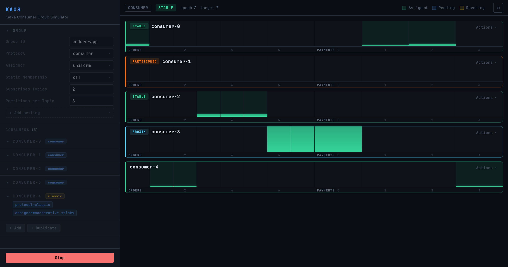

# Kaos

*A playground for Apache Kafka consumer groups: run them, break them,
and watch them rebalance.*

Kaos is an interactive simulator of Apache Kafka consumer groups. It
runs real Kafka consumers and producers against a cluster, lets you
disturb them, and shows live how the group rebalances: which partitions
each consumer owns, receives or gives up, and how the lag evolves. Use
it to learn how a group reacts to failures, to compare the `consumer`
protocol of
[KIP-848](https://cwiki.apache.org/confluence/display/KAFKA/KIP-848%3A+The+Next+Generation+of+the+Consumer+Rebalance+Protocol)
with the `classic` one, or to watch what a migration from one to the
other does to a running group.



*A group of five consumers on two topics: `consumer-1` is cut off the
network and has lost its partitions, `consumer-3` is frozen and its lag
grows, `consumer-4` speaks the classic protocol.*

## Quickstart

You need [Docker](https://docs.docker.com/get-docker/). Step 1 uses
Docker Compose, which comes with Docker Desktop; without it, see
[Without Compose](#without-compose).

1. Start a Kafka broker and Kaos:

   ```sh
   curl -fsSL https://raw.githubusercontent.com/dajac/kaos/main/compose.yaml | docker compose -f - up
   ```

   This runs [`compose.yaml`](compose.yaml): a one-broker cluster and
   Kaos, on one Docker network.

2. Open <http://localhost:8081>. The broker takes a few seconds to
   come up, so wait a moment before the first start.

3. Press **Start**. Kaos creates a topic, starts a producer and a group
   of three consumers, and shows one row per consumer with the
   partitions it owns.

4. Disturb the group. From the **Actions** menu of a consumer, try
   **Partition network**, **Freeze consumer** or **Downgrade to
   classic**, and watch the group react.

5. Press **Stop** when you are done: Kaos deletes the topics and the
   group it created. Ctrl-C stops the containers, and
   `docker compose -p kaos down` removes them.

The panel on the left sets up the group before a start: its protocol
and assignor, its topics and partitions, the number of consumers, and
per-consumer settings.

### Without Compose

The same setup in three commands: a network, a broker that advertises
its name on that network, and Kaos.

```sh
docker network create kaos

docker run -d --name kafka --network kaos \
  -e KAFKA_NODE_ID=1 \
  -e KAFKA_PROCESS_ROLES=broker,controller \
  -e KAFKA_LISTENERS=PLAINTEXT://:9092,CONTROLLER://:9093 \
  -e KAFKA_ADVERTISED_LISTENERS=PLAINTEXT://kafka:9092 \
  -e KAFKA_CONTROLLER_LISTENER_NAMES=CONTROLLER \
  -e KAFKA_LISTENER_SECURITY_PROTOCOL_MAP=CONTROLLER:PLAINTEXT,PLAINTEXT:PLAINTEXT \
  -e KAFKA_CONTROLLER_QUORUM_VOTERS=1@localhost:9093 \
  -e KAFKA_OFFSETS_TOPIC_REPLICATION_FACTOR=1 \
  apache/kafka:4.4.0

docker run --rm --network kaos -p 8081:8081 ghcr.io/dajac/kaos --bootstrap-server kafka:9092
```

Then follow steps 2 to 5 above. Ctrl-C stops Kaos, and
`docker rm -f kafka && docker network rm kaos` removes the rest.

## What you can do

- **Run a group of real consumers** on one or more topics, with the
  `consumer` protocol (KIP-848), the `classic` protocol, or a mix of
  both, and any assignor.
- **Inject faults** into a consumer: cut it off the network, freeze its
  poll loop, stop it and start it again.
- **Switch the protocol** of a consumer while the group runs, from
  `classic` to `consumer` and back.
- **Watch the coordinator's view**: the state and epoch of the group,
  the partitions each consumer owns or waits for, and the lag of every
  partition.

## Use your own Kafka cluster

Kaos works with any Kafka cluster from version 4.0, where the KIP-848
protocol is on by default (the assignment interval setting of a group
needs 4.3).

```sh
docker run --rm -p 8081:8081 ghcr.io/dajac/kaos --bootstrap-server <host>:<port>
```

Kaos connects to the bootstrap address, then to each broker at the
address the broker *advertises*. The container must reach those
addresses too:

- **A broker in Docker**: run Kaos on the network of the broker, and
  have the broker advertise an address that resolves on that network,
  as `compose.yaml` does:
  `docker run --rm --network <network> -p 8081:8081 ghcr.io/dajac/kaos --bootstrap-server <broker>:9092`.
- **A broker on your machine** that advertises `localhost:9092`: inside
  a container, `localhost` is the container itself. On Linux, add
  `--network host` (then `-p` is not needed). Elsewhere, run the jar
  instead (see below).

Kaos connects in plaintext, without authentication.

**Without Docker.** Download `kaos-server-<version>.jar` from the
[latest release](https://github.com/dajac/kaos/releases/latest) and run
it with Java 21:

```sh
java -jar kaos-server-<version>.jar --bootstrap-server localhost:9092
```

### Options

| Option | Default | Meaning |
|---|---|---|
| `--bootstrap-server` | `localhost:9092` | The Kafka cluster to connect to |
| `--port` | `8081` | The port of the UI and the HTTP API |
| `--proxy-port` | `19092` | The first port of the internal proxy that applies the network faults |

With Docker, the options follow the image name, and the UI moves to
another port with the `-p` mapping (`-p 9000:8081`) rather than
`--port`. `--help` lists the options and `--version` prints the
version.

## Versions

`ghcr.io/dajac/kaos` is the latest release, and `ghcr.io/dajac/kaos:0.1.0`
a given one. `ghcr.io/dajac/kaos:nightly` is built from `main` every
night, for trying what is not released yet. The quickstart runs the
version that `compose.yaml` names; `KAOS_VERSION` picks another:

```sh
curl -fsSL https://raw.githubusercontent.com/dajac/kaos/main/compose.yaml | KAOS_VERSION=nightly docker compose -f - up
```

## Automate it

Kaos has two APIs besides its UI: the HTTP API of the server, which the
UI itself uses, and the Java API of the `kaos-core` library, which the
server embeds. Both handle more than the UI shows: several groups,
independent producers (pause, rate), topics, producers, groups and
consumers added and removed while running, and the `connection-reset`
fault.

### HTTP API

The server exposes the model of the Java API as a versioned,
resource-oriented HTTP API under `/api/v1`: REST to change the
simulation, Server-Sent Events to follow it, and
[RFC 9457](https://www.rfc-editor.org/rfc/rfc9457) problem details for
errors. A running server describes it as an
OpenAPI 3.1 document at
[`/api/v1/openapi.yaml`](http://localhost:8081/api/v1/openapi.yaml); the
source is
[`kaos-server/src/main/resources/openapi/kaos-v1.yaml`](kaos-server/src/main/resources/openapi/kaos-v1.yaml).

Start a simulation with one topic, one producer and a group of three
consumers, one of which speaks the classic protocol:

```sh
curl -X POST localhost:8081/api/v1/simulator \
  -H 'Content-Type: application/json' \
  -d '{
        "topics": [{"name": "orders", "partitions": 12}],
        "producers": [{"topics": ["orders"]}],
        "groups": [{"id": "orders-app", "subscribedTopics": ["orders"],
                    "consumers": [{}, {}, {"overrides": {"protocol": "classic"}}]}]
      }'
```

Follow it: the stream sends the current `status` and `snapshot` on
connect, then each change.

```sh
curl -N localhost:8081/api/v1/simulator/events
```

Freeze a consumer, clear the fault, and stop the simulation:

```sh
curl -X PUT    localhost:8081/api/v1/simulator/groups/orders-app/consumers/consumer-0/faults/freeze
curl -X DELETE localhost:8081/api/v1/simulator/groups/orders-app/consumers/consumer-0/faults/freeze
curl -X DELETE localhost:8081/api/v1/simulator
```

`GET /api/v1/meta` returns the defaults, ranges, assignors and faults,
and `GET /api/v1/simulator/snapshot` the current snapshot.
[`kaos-server/src/test/scripts/curl-session.sh`](kaos-server/src/test/scripts/curl-session.sh)
drives a whole session against a running server.

### Java API

`kaos-core` has a fluent API in the package `io.github.dajac.kaos`: build
a `Simulator`, add topics, producers and groups, `start()` it, and drive
the consumers through their handles. `close()` removes everything it
created on the cluster.

```java
try (var simulator = new Simulator("localhost:9092")) {
    Topic orders = simulator.addTopic("orders", 12);
    simulator.addProducer(p -> p.topics(orders).ratePerPartition(2));

    ConsumerGroup group = simulator.addGroup("orders-app", g -> g
        .subscribe(orders)
        .consumerDefaults(c -> c.protocol(Protocol.CONSUMER).assignor("uniform"))
        .consumers(3) // consumer-0..2 inherit the defaults
        .consumer(c -> c.protocol(Protocol.CLASSIC).assignor("range"))); // consumer-3 overrides them

    simulator.start(); // creates the topics, starts the proxy, the producer and the consumers

    // Wait until every consumer is a stable member of the group.
    group.awaitSnapshot(
        s -> s.consumers().stream().allMatch(c -> c.status() == ConsumerStatus.STABLE),
        Duration.ofMinutes(1));

    // Cut consumer-0 off the network: the proxy drops its requests until the fault is cleared.
    ConsumerHandle c0 = group.consumer(0);
    c0.inject(Fault.networkIsolation());
    group.awaitSnapshot(s -> s.consumers().get(0).partitions().isEmpty(), Duration.ofMinutes(2));
    c0.clear(Fault.networkIsolation());

    // Upgrade consumer-3 to the consumer protocol while the group runs.
    group.consumer(3).switchProtocol(Protocol.CONSUMER);

    GroupSnapshot snapshot = group.snapshot();
    System.out.println(snapshot.state() + " at epoch " + snapshot.epoch() + ", lag " + snapshot.lag());
} // close() stops everything and deletes the topics and the group
```

The other faults are `Fault.freeze()` (the consumer stops polling) and
`Fault.connectionReset()` (the proxy closes its connections). Consumers
also `leave()` and `join()` the group; producers `pause()` and
`resume()`; and listeners
(`withListener`, `addListener`) receive every new snapshot. Kaos is not
published to a Maven repository yet: `./mvnw -pl kaos-core -am install
-DskipTests -DskipITs` installs `io.github.dajac:kaos-core`, at the
version of `pom.xml`, in the local Maven repository.

## Contributing

[CONTRIBUTING.md](CONTRIBUTING.md) explains how to build Kaos from
source and run the tests.

## License

Kaos is licensed under the [Apache License, Version 2.0](LICENSE).

## Trademarks

Apache, Apache Kafka, and Kafka are either registered trademarks or
trademarks of The Apache Software Foundation in the United States and/or
other countries. Kaos is not affiliated with, endorsed by, or sponsored
by The Apache Software Foundation.
