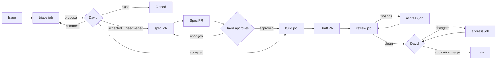

# Software factory

Status: design, under review. Nothing here is built yet.

## Problem and goals

Kaos is developed by Claude agents and reviewed by David, but the loop
runs by hand: David files an issue, asks a session to implement it, asks
again for an agent review, and checks the PR himself, screenshots and
manual testing included. The conventions exist (`[claude]` and
`[claude-review]` comment prefixes, the `ready`/`in-progress`/
`in-review` labels, the `issue-screenshots` branch) but nothing applies
them, some live only in one user's local memory, and every agent action
shows up on GitHub as David's.

The factory turns this into a pipeline with GitHub as its only state:

1. Every piece of work starts as a GitHub issue.
2. Every issue is triaged.
3. An accepted issue is spec'ed first when it needs one, implemented
   right away otherwise.
4. Every PR is reviewed by several agents, each from one angle (code,
   tests, rules, API, UX, Kafka semantics).
5. David has the final word: he accepts issues, approves specs and PRs,
   and is the only one who merges.
6. Every PR carries a description, screenshots when it touches the UI,
   and a one-command way to try it.

And, for David:

7. One command starts and stops the factory.
8. One orchestrator decides what runs.
9. A GitHub board shows the whole pipeline and what waits for him.
10. The factory acts as its own GitHub identity, a bot, never as David.

Non-goals: auto-merge, deployment, a hosted service.

## Overview



Three human gates, all David's: acceptance at triage, the spec approval
and the PR approval with the merge. Everything between them is
automatic, but each job stops at a gate rather than guessing.

## Architecture

Two kinds of processes, both local:

- **The orchestrator**, one per repository. A plain Node script, no
  model. It polls GitHub, applies the label transitions, starts and
  watches jobs, syncs the board, and cleans up after merges. Every
  decision it takes is mechanical and follows the tables below, so it
  is predictable, cheap and testable.
- **Jobs**, one per piece of model work: `triage`, `spec`, `build`,
  `review`, `address`. A job is a headless Claude Code session
  (`claude -p "/factory-<kind> <N>"`) in the issue's worktree. It does
  its work, posts its result on GitHub with a `yaml` handoff block, and
  exits. It never changes a stage label; the orchestrator reads the
  handoff and moves the stage.

```
           ┌──────────────────────────────┐
 GitHub ◄──┤ orchestrator (./factory up)  ├──► GitHub Project board
 (truth)   │ poll · transitions · limits  │    (David's token)
   ▲       └───────┬──────────────────────┘
   │               │ spawns, watches pid + log
   │       ┌───────┴────────┬──────────────┐
   └───────┤ build #75      │ review #81   │ … at most 2 jobs
   (bot)   │ claude -p      │ claude -p    │
           │ worktree 75-…  │ 6 reviewer   │
           └────────────────┤ subagents    │
                            └──────────────┘
```

Why this split:

- **One orchestrator.** It holds a lock file
  (`.factory/orchestrator.lock`), so a second `./factory up` refuses to
  start. Only the orchestrator starts jobs, including the ones David
  asks for by hand (`./factory run build 75` sends the request to it),
  so two jobs never race for one issue and no claim protocol is needed.
- **Jobs are top-level sessions.** A Claude Code subagent cannot start
  subagents. A review job is a top-level session, so it can fan out to
  the six reviewer subagents.
- **Review is its own job.** It starts from a fresh context with no
  access to the build job's reasoning, which keeps the reviewers
  independent of the author.
- **Small contexts.** Each job sees one issue and ends. Nothing
  accumulates across issues, unlike a long `/loop` session.

The orchestrator keeps a little local runtime state in `.factory/`
(gitignored): the lock, one file per running job (pid, kind, issue,
start time, log path) and the job logs. GitHub stays the truth: after a
crash or a reboot, the orchestrator rebuilds everything from the labels,
the PRs and the timeline, and treats a job whose pid is gone as dead.

### Limits

- At most two jobs at a time, at most one `build`.
- No new `build` while two PRs wait for David: his review is the
  bottleneck, so the factory does not pile work up in front of him.
- Each job has a time limit (`build` 90 minutes, others 30) and a
  budget cap passed to `claude -p`. A job that hits one is killed and
  its issue goes to `blocked` with the tail of its log.
- A poll costs no model work. It is a few `gh api` calls every two
  minutes, and nothing runs when nothing changed.

### Permissions of a job

Headless jobs cannot ask for permission, so the committed
`.claude/settings.json` allowlists what they need (`./mvnw`, `npm`,
`git`, `gh`, `docker`, the factory scripts, edits in the worktree), and
the guard hook (see "Guardrails") refuses what they must never do. A
job that needs anything else fails cleanly and its issue goes to
`blocked`. It never hangs on a prompt.

## Running it

One script at the root of the repository, `./factory`:

| Command | Does |
|---|---|
| `./factory setup` | One-time: checks `claude`, `gh`, Docker and Node, creates the labels and the board, stores the bot's key in the macOS Keychain, checks that both tokens work |
| `./factory up` | Starts the orchestrator in the background; `--foreground` to watch it |
| `./factory down` | Stops the orchestrator; running jobs finish, or `--now` kills them |
| `./factory status` | The pipeline in the terminal: what waits for David, running jobs, blocked issues |
| `./factory logs [N]` | Follows the orchestrator log, or the log of the job of issue N |
| `./factory run <kind> <N>` | Asks the orchestrator to run one job now, e.g. `./factory run triage 76` |
| `./factory pause` / `resume` | Stop or restart new jobs without stopping the orchestrator |
| `./factory try <PR>` | Builds and runs the PR locally with its scenario (see "Try it") |
| `./factory merge <PR>` | David's merge (see stage 6) |

`./factory up --at-login` installs a launchd agent instead, so the
orchestrator survives reboots. Inside an interactive Claude Code
session, `/factory` prints the same status and can call `./factory run`.

Local first: builds and UX reviews need Docker, a broker and a browser,
which David's machine has. Since the orchestrator and the jobs only
talk to GitHub, they can later move to a server or a cloud runner
without changing the job contract.

## Identity: the bot

The factory acts as a GitHub App, `kaos-factory`, owned by David and
installed on `dajac/kaos` only. Its comments, reviews, pushes, labels
and PRs show as `kaos-factory[bot]`.

- **Permissions:** Contents, Issues and Pull requests read and write;
  Checks, Commit statuses and Actions read (to follow CI); Metadata
  read. No administration, no workflows, nothing outside the repo.
- **Credentials:** the App's private key lives in the macOS Keychain.
  `scripts/factory/token.sh` signs a JWT and exchanges it for an
  installation token, valid one hour and refreshed by the orchestrator.
  Jobs get it as `GH_TOKEN` for `gh` and through a `GIT_ASKPASS` helper
  for `git push`. David's own `gh` login is never used by a job.
- **Commits** are authored by the bot, with
  `Co-Authored-By: Claude <noreply@anthropic.com>`.

What the bot makes simpler:

- **No more comment prefixes.** The author tells David's comments
  from the factory's. Reviewer comments start with their angle in
  bold, e.g. **UX review**, for readability only.
- **David's gates can be checked.** `accepted` counts only when the
  issue timeline shows David (`dajac`) adding it. If the bot adds it,
  the orchestrator removes it and flags the issue.
- **Real approvals.** David can review a bot PR on GitHub. "Approve"
  replaces the "LGTM" comment and "Request changes" sends it back,
  for specs and code alike.
- **Notifications.** The factory requests David's review when a PR is
  ready, so it lands in his GitHub review queue and inbox. Before,
  his own actions did not notify him.

What it does not fix: a free private repository has no branch
protection or rulesets, so the App, which needs Contents write to push
branches, could merge or push to `main` too. The guard hook remains the
only barrier there. Moving the repository to a free organization, or
going public, would allow a ruleset on `main` that blocks pushes and
requires David's approval, which closes that hole server side.

## The board: GitHub Projects

A GitHub Project, **Kaos factory**, shows the whole pipeline.

- **Items:** every open issue of `dajac/kaos`, added by the project's
  built-in auto-add workflow. Closed issues move to Done through the
  built-in workflow.
- **Status field**, one option per stage: Triage · Waiting for David ·
  Needs info · Queued · Spec · Building · Reviewing · Changes requested ·
  Blocked · Done.
- **Waiting on field:** David, Factory or Reporter.
- **More fields:** PR (link), Job (running, idle or failed), Areas,
  Round (review round).
- **Views:**
  - *Pipeline*: a board grouped by Status.
  - *David*: a table filtered on "Waiting on: David", oldest first.
  - *In flight*: a table of the issues with a running job.

The labels stay the source of truth, and the orchestrator mirrors them
onto the board on every poll.

GitHub Apps can only reach projects owned by an organization, not by a
user. The board is David's (user-owned), so the orchestrator writes to
it with a second token: David's own, with the `project` scope, also in
the Keychain. Writing a field on a board notifies no one and shows no
authorship on the repo. If the repository moves to an organization,
the board moves with it and the bot's token covers both.

GitHub already offers two other views without the board: the labels,
as saved issue searches, and David's review queue
(`github.com/pulls/review-requested`).

## State: labels and handoffs

### Labels

Two flags record David's decisions and never move:

- `accepted`: David accepted the work. **Only David adds it**, and the
  orchestrator checks this against the timeline.
- `needs-spec`: a spec must be approved before the build. The triage
  proposes it, David keeps or drops it, and the orchestrator removes it
  once David approves the spec.

The stage is a separate label, and an open issue has **exactly one**:

| Stage | Meaning | Board status |
|---|---|---|
| `needs-triage` | Not looked at yet | Triage |
| `triaged` | Proposal posted, waiting for David | Waiting for David |
| `needs-info` | Waiting for the reporter | Needs info |
| `queued` | Accepted, waiting for a job | Queued |
| `spec-review` | Spec PR open | Spec |
| `in-progress` | A build or address job is running | Building |
| `reviewing` | The draft PR is with the agent review | Reviewing |
| `in-review` | PR ready, waiting for David | Waiting for David |
| `changes-requested` | David asked for changes | Changes requested |
| `blocked` | Waiting on a decision, see the last bot comment | Blocked |

The orchestrator applies every transition (an arrow swaps the old
stage label for the new one):

| From | Event | To |
|---|---|---|
| none | issue opened, or any open issue without a stage label | `needs-triage`, start `triage` |
| `needs-triage` | `triage` handoff | `triaged` or `needs-info` |
| `needs-info` | a new comment from anyone but the bot | `needs-triage` |
| `triaged` | David adds `accepted` | `queued` |
| `triaged` | a new comment from David, no `accepted` | `needs-triage` |
| `queued` + `needs-spec` | a slot is free | `spec-review`, start `spec` |
| `spec-review` | David requests changes or comments | start `spec` again |
| `spec-review` | David approves the spec PR | `queued`, `needs-spec` removed |
| `queued`, no `needs-spec` | a build slot is free | `in-progress`, start `build` |
| `in-progress` | `build` or `address` handoff with a draft PR | `reviewing`, start `review` |
| `reviewing` | `review` handoff with findings, round < 2 | `in-progress`, start `address` |
| `reviewing` | `review` handoff clean, or round 2 without blockers | `in-review`: PR ready, review requested from David |
| `reviewing` | round 2 with blockers | `blocked` |
| `in-review` | David requests changes or comments | `changes-requested` |
| `changes-requested` | a slot is free | `in-progress`, start `address` |
| any | a job fails, times out or reports `blocked` | `blocked` |
| `blocked` | a new comment from David | the stage named in the blocking comment |
| `in-review` | David merges | issue closed by `Closes #N`, cleanup |

A "new comment" means one newer than the last bot comment on the issue
or its PR. The last bot comment is the watermark; the orchestrator
keeps no other state for this. `./factory status` and the board flag
any issue that breaks the one-stage invariant.

Type labels stay (`bug`, `enhancement`, `task`, `documentation`).
New area labels drive the reviewer selection: `area:core`,
`area:server`, `area:api`, `area:ui`, `area:build`, `area:protocol`,
`area:factory`. `priority:high` lets David jump the queue. Otherwise
the oldest `queued` issue goes first.

#### Migration

The existing `ready` label is removed rather than renamed. The eight
issues that carry it (#61, #63, #70, #72–#76) were never triaged, and
a rename would make them buildable at once. They go to `needs-triage`
and David re-accepts them from the proposals. `in-progress`,
`in-review`, `blocked` and `changes-requested` keep their names, with
new descriptions.

### Handoffs

A job ends with one comment whose last part is a fenced `yaml` block.
The orchestrator parses it to move the stage, so the next job does not
have to re-read prose:

````
```yaml
factory:
  job: triage
  type: bug
  areas: [ui]
  route: build          # build | spec | needs-info | close
  size: s               # s | m | l
  acceptance:
    - The ellipsis is "…" in both "Starting…" and "Stopping…"
  files: [kaos-ui/src/components/Toolbar.tsx]
```
````

A job that ends without a valid handoff counts as failed.

## Jobs

### 1. Issue intake

Issue forms in `.github/ISSUE_TEMPLATE/` (`bug.yml`, `feature.yml`,
`task.yml`) ask for the problem, the repro or motivation, the expected
behavior and the scope. Blank issues stay allowed for David; the
orchestrator gives every unlabeled issue `needs-triage`.

UI issues carry annotated screenshots on the orphan `issue-screenshots`
branch, as today. `gh` cannot upload attachments to a private repo.

### 2. `triage`

The job:

- reproduces the bug when it can (build, run, `GET
  /api/v1/simulator/snapshot`) and says whether it did;
- finds duplicates and related issues and PRs;
- locates the code and the part of `docs/ARCHITECTURE.md` involved;
- proposes the type, areas, size, route and acceptance criteria, and
  applies the type and area labels;
- posts the proposal with its handoff.

Route rules, which David can override:

- **spec** when the issue changes the public Java API, the HTTP API or
  its JSON, the UX of a whole view, the architecture, or the factory
  itself; when it spans several PRs; or when the triage found two
  reasonable designs and cannot pick one.
- **build** otherwise: bugs with a clear expected behavior, small UI
  fixes, tasks, docs.
- **needs-info** when the expected behavior cannot be inferred.
- **close** for duplicates and things already fixed. This is only a
  proposal; David closes.

David answers in one of three ways:

- He adds `accepted`, keeping `needs-spec` or removing it.
- He comments. The issue goes back to triage, which revises its
  proposal.
- He closes the issue.

### 3. `spec`

For an accepted issue with `needs-spec`:

- branch `spec/<N>-<slug>` from `main`, in its own worktree, adding
  `docs/specs/<N>-<slug>.md`. The spec covers:
  - the problem and the proposed behavior;
  - API and JSON changes;
  - the UX, with mockups or screenshots of a throwaway prototype for
    UI work;
  - the alternatives;
  - the impact on `docs/ARCHITECTURE.md`;
  - the test strategy;
  - the planned PR stack, when the work spans several PRs;
- opens the spec PR (`Spec: <title>`, body `Spec for #N`) and requests
  David's review;
- on later runs, addresses David's comments with the same rules as the
  `address` job.

Once David approves it, the orchestrator closes the spec PR. Specs are
not merged, because `docs/ARCHITECTURE.md` describes the merged code
and the implementation PR updates it. The branch stays until the issue
is closed. A spec that turns out wrong during the build goes back to
David: the build job comments on the spec PR and reports `blocked`,
rather than quietly departing from the spec.

### 4. `build`

The job:

1. Creates the worktree `.claude/worktrees/<N>-<slug>` on branch
   `<N>-<slug>` from `main`.
2. For a bug, writes a test that fails on `main` first.
3. Implements, following `CLAUDE.md` and the spec; updates
   `docs/ARCHITECTURE.md` in the same PR.
4. Runs `scripts/factory/gates.sh` (below) until it is green, with at
   most three fix attempts per failing step. A test that also fails on
   `main`, or passes on a rerun without a change, is a flake. The job
   files it as its own issue, says so in the PR, and goes on.
   Otherwise it reports `blocked`.
5. When the diff touches `kaos-ui/`, captures the screenshots (below),
   whatever the triage areas said.
6. Opens a **draft** PR with the body below and hands off.

Draft means it is the agents' turn. Ready for review, with David's
review requested, means it is David's turn.

#### Stacked PRs

When the spec plans a stack, the spec's PR list becomes a checklist on
the issue:

- Each PR branches from its parent, has the parent's branch as base,
  and says `Part of #N`. Only the last one says `Closes #N`.
- The issue loops through `queued` → … → `in-review` once per PR. The
  orchestrator starts the next PR as soon as the previous one is ready
  for review.
- When a PR of the stack is merged, the orchestrator starts an
  `address` job on its child. The job rebases the child onto `main`
  (`git rebase --onto main <parent> <child>`), reruns the gates and
  force-pushes. The orchestrator then retargets the child PR to `main`.

#### PR body

The part above the `---` rule is the squash commit message, following
the usual title and body rules. The part below is review material,
which `./factory merge` drops.

```markdown
<context, what the change does, optional "Changes:" list>

Closes #N

---

## How to test

    ./factory try 81

Then:
1. Open the URL the command prints.
2. Freeze consumer-0 and wait one minute.
3. Expected: the badge and "Actions" stay readable over the full cell.

## Screenshots

| Before (`main`) | After |
|---|---|
|  |  |

## Checks

- `scripts/factory/gates.sh full`: PASS (log excerpt)
- New tests: `RowStripTest` fails on `main`, passes here.

## Decisions for David

- …anything the agent decided that the issue or spec did not.
```

#### Gates

`scripts/factory/gates.sh [quick|full]` runs the checks and ends with
one verdict line: `GATES: PASS`, `GATES: FAIL <step>` or
`GATES: MISCONFIGURED <why>` (Docker missing, Node too old). Jobs quote
that line, so a skipped step can never read as a pass.

- `quick`: `./mvnw spotless:apply`, then `./mvnw verify -DskipITs`.
- `full`: `./mvnw verify`, integration tests included (needs Docker).
  Required before a PR leaves draft.

CI keeps running `./mvnw verify` on every PR. The orchestrator moves a
PR to `in-review` only once CI is green, and waits at most 30 minutes.
A red or timed-out CI starts an `address` job, which follows the same
flake rule as the local gates.

#### Try it and screenshots

`./factory try <PR|branch> [--scenario <file>]`
(`scripts/factory/try-pr.sh`) does four things:

1. creates or reuses a worktree for the branch and builds the shaded
   jar (`-DskipTests`);
2. starts its own `apache/kafka:4.3.1` container on a free port, so
   that parallel runs never share topics or groups (for example David
   trying one PR while a review job runs another); `--bootstrap-server`
   reuses an existing broker instead;
3. runs the server with `--port 0` and a free proxy port and, with
   `--scenario`, drives it to a known state through the HTTP API
   (create the topic, start the group, freeze a consumer...); a PR's
   own scenario is the default;
4. prints the URL, then stops everything, the container included, on
   Ctrl-C or with `--stop`.

Scenarios are small JSON files under `scripts/factory/scenarios/`: a
list of HTTP calls and waits. David, the build job and the UX reviewer
all see the same state.

Screenshots use Playwright, as a dev dependency of `kaos-ui` that is
never shipped in the jar. A PR adds or reuses a capture script under
`kaos-ui/e2e/`. The script loads a scenario, performs the interactions
(hover, open a menu) and saves PNGs.

The build job runs the capture twice, against `main` and against the
branch. It commits the images to the `issue-screenshots` branch under
`pr-<N>/` and links them in the body. Each PR writes only its own
directory, so a push rejected by a concurrent one is simply retried
after a fetch and rebase; it never conflicts. Both light and dark
themes are captured when the change affects colors.

### 5. `review`

A review job runs on every draft PR the orchestrator hands it, and
again after each `address` round. It picks the reviewers from the
changed paths and runs them in parallel as subagents in
`.claude/agents/reviewer-*.md`.

| Reviewer | When | Looks at |
|---|---|---|
| `code` | always | correctness, edge cases, concurrency and shutdown, error paths, simplicity, reuse |
| `tests` | always | the new test fails without the change (it reverts the fix to check), coverage of the acceptance criteria, flakiness (sleeps, ports, timing) |
| `rules` | always | `CLAUDE.md` rules (public vs `internal`, no kafka-clients type in the API or JSON, no static mutable state, the single `ThreadFactory`, `*Test` names, `@IntegrationTest`, `var`), `docs/ARCHITECTURE.md` matches the code, PR body complete |
| `api` | public package of `kaos-core`, `kaos-server`, OpenAPI | naming and consistency with the existing API, compatibility, JSON shape, OpenAPI and `schema.d.ts` in sync, error responses |
| `ux` | `kaos-ui` | runs `./factory try` with the scenario and drives the UI with headless Playwright; the rows show the coordinator view (client-local facts only annotate); wording and labels consistent with the rest of the UI; WCAG AA contrast, keyboard focus, states (loading, stale, stopped); the screenshots match what it sees |
| `kafka` | the consumer, group, assignment, proxy and fault code of `kaos-core`, or `area:protocol` | the simulated behavior matches the real group coordinator and clients, checked against the Apache Kafka sources at the tag of the kafka-clients version in the `pom.xml` (KIP-848 and classic protocols, epochs, revocation, static membership) |

Each reviewer is independent. It gets the issue, the spec, the
acceptance criteria and the diff, not the build job's reasoning. It
does not trust the PR body's claims without checking them. It returns
findings with a file, a line, a severity (`blocker`, `major`, `minor`,
`nit`) and a failure scenario.

A final `verifier` subagent drops the findings it cannot confirm and
merges duplicates. The survivors are posted as one PR review per
angle, with inline comments. On round 2, only the angles that had
findings re-review, and only their threads and the new diff.

The `address` job replies to every thread (fixed in `<sha>`, or why
not) and pushes new commits, never a force-push.

After at most two rounds the orchestrator either hands the PR to David
or blocks it:

- **Clean, or only `minor` and `nit` left:** it marks the PR ready for
  review and requests David's review. The review job's last comment
  summarizes it for David:
  - each reviewer's verdict;
  - the findings left open, with the reason;
  - the "Decisions for David";
  - what to look at first.
- **Blockers left after round 2:** the PR stays a draft and the issue
  goes to `blocked` with the open question.

The review guides (what each angle checks, with Kaos examples) live in
`docs/factory/review/<angle>.md`, so they are versioned and shared.
Lessons that today sit in one user's local memory move there: the
coordinator view, screenshots on UI issues, the independent review.

### 6. `address`, David's review and the merge

David reviews the ready PR on GitHub. "Request changes" or a comment
moves the issue to `changes-requested`, and an `address` job:

1. fixes;
2. replies once per thread, and never resolves one;
3. reruns the gates, and the screenshots if the UI moved;
4. pushes new commits.

A light `review` round follows (`code`, `rules` and the reviewers of
the touched paths) before the PR comes back to David.

Approval is David's GitHub "Approve" with every thread resolved and CI
green. Only David merges, in one of two ways:

- `./factory merge <PR>`: it runs with David's own `gh` login, checks
  the approval, the threads and CI, and squashes with the part of the
  body above `---`.
- The "Squash and merge" button, after trimming the message himself.

The orchestrator does the cleanup either way, after it sees the merge:

- deletes the branch, and the spec branch with the last PR of the
  issue;
- removes the worktree;
- rebases the child of a stacked PR;
- moves the item on the board.

`Closes #N` closes the issue.

## Guardrails

A `PreToolUse` hook, `.claude/hooks/factory-guard.sh`, registered in
the committed `.claude/settings.json`, refuses these commands from any
session, jobs and interactive ones alike:

- `gh pr merge`, `./factory merge`, `git push` to `main`, and any
  force-push to `main` or to `issue-screenshots`;
- adding the `accepted` label, through `gh issue edit` or `gh api
  …/labels`;
- `gh issue close`, the `resolveReviewThread` GraphQL mutation, and
  `gh pr review --approve`;
- deleting the `issue-screenshots` branch.

It matches these exact subcommands, so `Closes #N` in a PR body stays
allowed. Hooks are a guardrail, not a security boundary: the job
instructions state the same rules, and the orchestrator checks the
`accepted` gate against the timeline. Changes to the factory itself
(`factory`, `.claude/`, `scripts/factory/`, `docs/factory/`,
`.github/`) always go through a spec, and the `rules` reviewer flags
them.

## Files

```
factory                               the CLI (bash, calls the Node scripts)
scripts/factory/orchestrator.mjs      poll, transitions, jobs, board sync
scripts/factory/github.mjs            the REST and GraphQL calls, no npm dependency
scripts/factory/{token,gates,try-pr,merge}.sh
scripts/factory/scenarios/*.json
scripts/factory/test/                 tests of the transitions on recorded GitHub states
.claude/settings.json                 allowlist, hook
.claude/hooks/factory-guard.sh
.claude/skills/factory/SKILL.md       /factory in an interactive session
.claude/skills/factory-{triage,spec,build,review,address}/SKILL.md
.claude/agents/reviewer-{code,tests,rules,api,ux,kafka}.md
.claude/agents/review-verifier.md
.github/ISSUE_TEMPLATE/{bug,feature,task}.yml, config.yml
.github/pull_request_template.md
kaos-ui/e2e/                          Playwright capture scripts
docs/factory/README.md                the process, for humans
docs/factory/review/<angle>.md        review guides
docs/specs/                           only on spec branches
.factory/                             runtime state and logs, gitignored
```

The orchestrator is Node because the build already requires Node 24
for `kaos-ui`. It uses only the standard library (`fetch`,
`child_process`), so the factory adds no dependency to the product.

`CLAUDE.md` gets a short "Factory" section pointing to
`docs/factory/README.md`.

`.gitignore` ignores the whole `.claude/` today, so none of the files
above would be committed. It becomes `.claude/*` with exceptions for
`settings.json`, `hooks/`, `skills/` and `agents/`;
`settings.local.json` and `worktrees/` stay ignored. `.factory/` is
added.

## Alternatives considered

- **A Claude session as orchestrator** (`/loop /factory tick`). Simple
  to start, but every tick costs model work, the session's context
  grows with every issue, and the decisions are not reproducible. The
  transitions are mechanical, so a script takes them better.
- **Everything in GitHub Actions** (`claude-code-action` on issue and
  PR events). Event-driven and hands-off, but the runners have no
  browser for the UX review, every run pays a cold Maven and npm
  build, and it needs an API key in the repo. Still possible later for
  triage only, since the job contract is the same.
- **A machine user** (a second GitHub account, e.g. `kaos-bot`) instead
  of an App. It can reach a user-owned board and needs no token
  minting, but it is a full account with a long-lived token, counts as
  a collaborator, and its actions look like a person's. The App is the
  real bot, with short-lived tokens scoped to one repo.
- **Moving `kaos` to a free organization now.** It would give the
  ruleset on `main` and let the App own the board, but it changes the
  repo's URLs and settings. It is left as an open question.
- **A local job directory as state** (zazencodes' factory). Invisible
  on GitHub and tied to one machine.
- **An agent approver that merges low-risk PRs** (zazencodes).
  Rejected: David has the final word on every change.
- **A single reviewer agent** (today). Cheaper, but one context mixes
  angles and misses the UX and Kafka-semantics issues found in the
  release review (#54–#75).

## Rollout

Each step is one PR, usable on its own:

1. The bot: create the App, `token.sh`, `./factory setup`; the labels
   and their migration; issue forms; PR template; `docs/factory/README.md`;
   the `.gitignore` changes and the `CLAUDE.md` pointer.
2. `.claude/settings.json`, the guard hook, `gates.sh`, `./factory merge`.
3. The orchestrator with the transitions, its tests, the board sync,
   `./factory up/down/status/logs/run`, and the `triage` job. Pilot on
   the open issues.
4. `./factory try`, the scenarios, the Playwright capture, and the
   `build` job.
5. The reviewers, the verifier, the review guides, and the `review`
   job.
6. The `spec` and `address` jobs, and stacked PRs.

Pilot candidates: #73 (ellipses, trivial UI), #75 (classic consumer
configs, core bug), #76 (remove the auto-pilot, likely a spec).

## Open questions

1. Move `kaos` to a free organization? That would give branch
   protection on `main` and a board the bot can own, at the cost of
   new URLs.
2. Should small bugs that David files himself be accepted
   automatically? This design says no: `accepted` is always his.
3. Playwright as a `kaos-ui` dev dependency, or headless Chrome driven
   from a script with no new dependency?
4. Should the part of the PR body below `---` be dropped at merge? It
   changes the current style: the "Checks" section of #53 landed in
   the commit.
5. Should the bot author the commits, or should David be the author
   with the bot as committer?
6. The `kafka` reviewer runs only on the consumer, group, proxy and
   fault paths of `kaos-core`. Is that the right scope?
