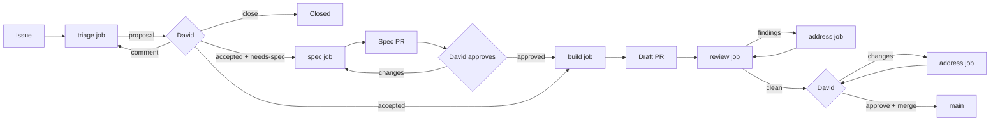

# Software factory

Status: design, under review. Nothing here is built yet.

## Problem and goals

Kaos is developed by Claude agents and reviewed by David, but the loop
runs by hand: David files an issue, asks a session to implement it, asks
again for an agent review, and checks the PR himself, screenshots and
manual testing included. The conventions exist (`[claude]` and
`[claude-review]` comment prefixes, the `ready`/`in-progress`/
`in-review` labels, the `issue-screenshots` branch) but nothing applies
them, some live only in one user's local memory, and every agent action
shows up on GitHub as David's.

The factory turns this into a pipeline with GitHub as its only state:

1. Every piece of work starts as a GitHub issue.
2. Every issue is triaged.
3. An accepted issue is spec'ed first when it needs one, implemented
   right away otherwise.
4. Every PR is reviewed by several agents, each from one angle (code,
   tests, rules, API, UX, Kafka semantics).
5. David has the final word: he accepts issues, approves specs and PRs,
   and is the only one who merges.
6. Every PR carries a description, screenshots when it touches the UI,
   and a one-command way to try it.

And, for David:

7. One command starts and stops the factory.
8. One orchestrator decides what runs.
9. One place on GitHub shows the whole pipeline and what waits for him.
10. The factory acts as its own GitHub identity, a bot, never as David.

Non-goals: auto-merge, deployment, a hosted service.

## Overview



Three human gates, all David's: acceptance at triage, the spec approval
and the PR approval with the merge. Everything between them is
automatic, but each job stops at a gate rather than guessing.

## Architecture

Two kinds of processes, both local:

- **The orchestrator**, one per repository. A plain Node script, no
  model. It polls GitHub, applies the label transitions, starts and
  watches jobs, updates the Pipeline issue, and cleans up after merges. Every
  decision it takes is mechanical and follows the tables below, so it
  is predictable, cheap and testable.
- **Jobs**, one per piece of model work: `triage`, `spec`, `build`,
  `review`, `address`. A job is a headless Claude Code session
  (`claude -p "/factory-<kind> <N>"`). It does its work, posts its
  result on GitHub with a `yaml` handoff block, and exits. It never
  changes a stage label; the orchestrator reads the handoff and moves
  the stage.

Each job runs in a worktree under `.claude/worktrees/`, which the
orchestrator prepares:

| Job | Worktree |
|---|---|
| `triage` | `triage-<N>`, detached at `main`, removed afterwards |
| `spec` | `spec-<N>-<slug>` on branch `spec/<N>-<slug>` |
| `build`, `address` | `<N>-<slug>` on branch `<N>-<slug>`, kept until the merge |
| `review` | `review-<N>`, detached at the PR head, removed afterwards, so that the `tests` reviewer can revert the fix without touching the author's worktree |

```
           ┌──────────────────────────────┐
 GitHub ◄──┤ orchestrator (./factory up)  ├──► Pipeline issue
 (truth)   │ poll · transitions · limits  │    (bot)
   ▲       └───────┬──────────────────────┘
   │               │ spawns, watches pid + log
   │       ┌───────┴────────┬──────────────┐
   └───────┤ build #75      │ review #81   │ … at most 2 jobs
   (bot)   │ claude -p      │ claude -p    │
           │ worktree 75-…  │ 6 reviewer   │
           └────────────────┤ subagents    │
                            └──────────────┘
```

Why this split:

- **One orchestrator.** It holds a lock file
  (`.factory/orchestrator.lock`), so a second `./factory up` refuses to
  start. Only the orchestrator starts jobs, including the ones David
  asks for by hand (`./factory run build 75` sends the request to it),
  so two jobs never race for one issue and no claim protocol is needed.
- **Review is its own job.** It starts from a fresh context and a
  fresh checkout, with no access to the build job's reasoning, which
  keeps the reviewers independent of the author. It fans out to the
  reviewer subagents itself.
- **Small contexts.** Each job sees one issue and ends. Nothing
  accumulates across issues, unlike a long `/loop` session.

The orchestrator keeps a little local runtime state in `.factory/`
(gitignored): the lock, one file per running job (pid, kind, issue,
start time, log path), the job logs and the current bot token. GitHub
stays the truth: after a crash or a reboot, the orchestrator rebuilds
everything from the labels, the PRs and the timeline. For an issue in
`in-progress`, `reviewing` or `spec-review` with no live job, it looks
for a valid handoff newer than the stage label: if there is one, the
job finished while the orchestrator was down and the handoff is
applied; otherwise the job died and the issue goes to `blocked`.

### Limits

- At most two jobs at a time, at most one `build`.
- No new `build` while two PRs wait for David: his review is the
  bottleneck, so the factory does not pile work up in front of him.
- Each job has a time limit (`build` 90 minutes, others 30) and a
  budget cap passed to `claude -p`. A job that hits one is killed and
  its issue goes to `blocked` with the tail of its log.
- A poll costs no model work. It is a few `gh api` calls every two
  minutes, and nothing runs when nothing changed.

### Permissions of a job

Headless jobs cannot ask for permission. Without a mode, a `-p` run
can start in `auto`, so the orchestrator always passes one:

    claude -p "/factory-build 75" \
      --permission-mode dontAsk --permission-prompts none \
      --settings <main checkout>/.claude/factory-job.json \
      --max-budget-usd <cap> --output-format stream-json --verbose

- `dontAsk` denies every call that no allow rule covers, and
  `--permission-prompts none` tells Claude not to retry a denied call.
  A job that needs something not allowed fails cleanly, and its issue
  goes to `blocked`; it never hangs on a prompt.
- `factory-job.json` holds the allowlist (`./mvnw`, `npm`, `git`, `gh`,
  `docker`, the factory scripts, edits in the worktree), the deny rules
  and the guard hook (see "Guardrails"). It is read from the **main
  checkout**, not from the job's worktree. A job can edit its own
  branch's `.claude/`, but not the rules that bind it: deny rules win
  over any allow rule the branch adds, and the hook from the main
  checkout runs whatever the branch's copy says.
- The `stream-json` log, `.factory/logs/<N>-<kind>.jsonl`, is what
  `./factory logs` follows and what the `blocked` comment quotes.

## Running it

One script at the root of the repository, `./factory`:

| Command | Does |
|---|---|
| `./factory setup` | One-time: checks `claude`, `gh`, Docker and Node, creates the bot, the labels and the Pipeline issue, stores the bot key in the macOS Keychain, checks that every GitHub action comes out as the bot |
| `./factory up` | Starts the orchestrator in the background; `--foreground` to watch it |
| `./factory down` | Stops the orchestrator; running jobs finish, or `--now` kills them |
| `./factory status` | The pipeline in the terminal: what waits for David, running jobs, blocked issues |
| `./factory logs [N]` | Follows the orchestrator log, or the log of the job of issue N |
| `./factory run <kind> <N>` | Asks the orchestrator to run one job now, e.g. `./factory run triage 76` |
| `./factory pause` / `resume` | Stop or restart new jobs without stopping the orchestrator |
| `./factory try <PR>` | Builds and runs the PR locally with its scenario (see "Try it") |
| `./factory merge <PR>` | David's merge (see stage 6) |

`./factory up --at-login` installs a launchd agent instead, so the
orchestrator survives reboots. launchd does not inherit the shell's
`PATH`, so `setup` records the absolute paths of `claude`, `gh`,
`docker` and `node`, and runs a dry job under launchd to check that
the Keychain items can be read without a prompt. Inside an interactive Claude Code
session, `/factory` prints the same status and can call `./factory run`.

Local first: builds and UX reviews need Docker, a broker and a browser,
which David's machine has. Since the orchestrator and the jobs only
talk to GitHub, they can later move to a server or a cloud runner
without changing the job contract.

## Identity: the bot

The factory acts as a GitHub App, `kaos-agent`, owned by David and
installed on `dajac/kaos` only. Its comments, reviews, pushes, labels
and PRs show as `kaos-agent[bot]`.

- **Creation:** `./factory setup` creates the App with GitHub's App
  manifest flow (one browser confirmation), installs it on the repo and
  stores the private key in the macOS Keychain.
- **Permissions:** Contents, Issues and Pull requests read and write;
  Checks, Commit statuses and Actions read (to follow CI); Metadata
  read. No administration, nothing outside the repo, and no Workflows
  permission: the bot cannot push a change under `.github/workflows/`.
  Such a change is always factory work, which goes through a spec, and
  the job hands David a patch to push himself.
- **Tokens:** `scripts/factory/token.sh` signs a JWT and exchanges it
  for an installation token, valid one hour. The orchestrator refreshes
  it into `.factory/token` every 45 minutes, and jobs read it from
  there on every call, since a build can outlive one token.
- **`dajac` is David's only.** Nothing the factory or any Claude
  session does appears under `dajac`: no PR, comment, review, label,
  push or commit. This holds for jobs and for interactive Claude Code
  sessions in the repository alike, so Claude can never fall back to
  David's credentials:
  - `gh` runs with `GH_CONFIG_DIR` set to an empty directory, through
    a wrapper that sets `GH_TOKEN` from `.factory/token`.
  - `git` runs with `credential.helper` reset and replaced by a helper
    that prints the bot token. Otherwise the macOS Keychain helper,
    which holds David's credentials, answers first.
  - `git` author and committer are the bot
    (`kaos-agent[bot] <<app-user-id>+kaos-agent[bot]@users.noreply.github.com>`),
    through `GIT_AUTHOR_*` and `GIT_COMMITTER_*`, so the local
    `user.name` (David) is never used.
  - Jobs get this environment from the orchestrator. Interactive
    sessions get it from a `SessionStart` hook in the committed
    `.claude/settings.json`, which writes it to `CLAUDE_ENV_FILE`.
  - The guard hook refuses any `gh` or `git push` command when the
    environment does not carry the bot's identity, so a missing token
    makes the command fail; it does not fall back to `dajac`.
  - `setup` checks it: `gh api user`, a `git push --dry-run` and a
    test commit from a job environment and from an interactive session
    must all come out as the bot.

  David's own terminal, outside Claude, keeps his login: his merges,
  approvals and comments are his.
- **Commits** are authored by the bot, with
  `Co-Authored-By: Claude <noreply@anthropic.com>`, and so is the
  squash commit that lands on `main`, although David merges. GitHub's
  merge API takes no author, so rollout step 2 checks on a test PR who
  GitHub records as the author of a squash merged by David. If it is
  David, `./factory merge` instead lets the orchestrator merge with the
  bot's token once David has approved and run the command, so the
  merge stays David's decision and the bot stays the author. The
  audit of `main` then expects the bot as the merger of factory PRs.

What the bot makes simpler:

- **No more comment prefixes.** The author tells David's comments
  from the factory's. Reviewer comments start with their angle in
  bold, e.g. **UX review**, for readability only.
- **David's gates can be checked.** `accepted` counts only when the
  issue timeline shows David (`dajac`) adding it. If the bot adds it,
  the orchestrator removes it and flags the issue.
- **Real approvals.** David can review a bot PR on GitHub. "Approve"
  replaces the "LGTM" comment and "Request changes" sends it back,
  for specs and code alike.
- **Notifications.** The factory requests David's review when a PR is
  ready, so it lands in his GitHub review queue and inbox. Before,
  his own actions did not notify him.

What it does not fix: on GitHub Free, private repositories have no
branch protection or rulesets, for personal accounts and free
organizations alike. The App needs Contents write to push branches, so
it could also merge or push to `main`. The guard hook and the deny
rules are the barrier, and the orchestrator detects a breach after the
fact: on every poll it checks that each new commit on `main` comes
from a PR merged by David. If one does not, it stops starting jobs,
kills the running ones and alerts David. GitHub Pro would allow a
ruleset on `main` that closes the hole server side; it is left out for
now and can be added later without changing the design.

## The overview: the Pipeline issue

A pinned issue, **Pipeline**, opened by the bot, shows the whole
pipeline. The orchestrator rewrites its body when the state changes.
Editing an issue body notifies no one, so the issue does not spam
David.

```markdown
Updated 2026-10-16 09:14 UTC · orchestrator up · 2 jobs running · paused: no

## Waiting for David (3)
| Issue | What | Since |
|---|---|---|
| #81 Row text unreadable | PR #90 ready for review | 2 h |
| #76 Remove the auto-pilot | spec PR #88 | 1 d |
| #91 Lag gauge legend | triage proposal | 10 min |

## In flight (2)
| Issue | Job | Started | PR |
|---|---|---|---|
| #75 Classic session timeout | build | 25 min | |
| #73 Ellipses | review, round 1 | 4 min | #89 |

## Queued (1) · Blocked (1) · Needs info (0)
…
```

The labels stay the source of truth; the issue is a view of them. The
other GitHub views remain:
- the labels as saved issue searches, e.g.
  `is:open label:in-review`;
- David's review queue, `github.com/pulls/review-requested`, since
  the bot requests his review on every ready PR.

A GitHub Projects board would look better, but GitHub Apps can only
write to projects owned by an organization, and the repository stays
under David's account. Syncing a board would therefore need David's
own token, which the factory never uses (see "Identity").

## State: labels and handoffs

### Labels

Two flags record David's decisions and never move:

- `accepted`: David accepted the work. **Only David adds it**, and the
  orchestrator checks this against the timeline.
- `needs-spec`: a spec must be approved before the build. The triage
  proposes it, David keeps or drops it, and the orchestrator removes it
  once David approves the spec.

The stage is a separate label, and an open issue has **exactly one**:

| Stage | Meaning | Pipeline section |
|---|---|---|
| `needs-triage` | Not looked at yet | Triage |
| `triaged` | Proposal posted, waiting for David | Waiting for David |
| `needs-info` | Waiting for the reporter | Needs info |
| `queued` | Accepted, waiting for a job | Queued |
| `spec-review` | Spec PR open | Spec |
| `in-progress` | A build or address job is running | Building |
| `reviewing` | The draft PR is with the agent review | Reviewing |
| `in-review` | PR ready, waiting for David | Waiting for David |
| `changes-requested` | David asked for changes | Changes requested |
| `blocked` | Waiting on a decision, see the last bot comment | Blocked |

The orchestrator applies every transition (an arrow swaps the old
stage label for the new one):

| From | Event | To |
|---|---|---|
| none | issue opened, or any open issue without a stage label | `needs-triage`, start `triage` |
| `needs-triage` | `triage` handoff | `triaged` or `needs-info` |
| `needs-info` | a new comment from anyone but the bot | `needs-triage` |
| `triaged` | David adds `accepted` | `queued` |
| `triaged` | a new comment from David, no `accepted` | `needs-triage` |
| `queued` + `needs-spec` | a slot is free | `spec-review`, start `spec` |
| `spec-review` | David requests changes or comments | start `spec` again |
| `spec-review` | David approves the spec PR | `queued`, `needs-spec` removed |
| `queued`, no `needs-spec` | a build slot is free | `in-progress`, start `build` |
| `in-progress` | `build` or `address` handoff, PR pushed | `reviewing`, start `review` (full after `build`, light after `address`) |
| `reviewing` | `review` handoff with open `blocker` or `major` findings, round 1 | `in-progress`, start `address` |
| `reviewing` | `review` handoff with only `minor` and `nit` left, CI green | `in-review`: PR ready, review requested from David |
| `reviewing` | round 2 with an open `blocker` or `major` | `blocked` |
| `reviewing`, `in-review` | CI red, or not done after 30 minutes | `in-progress`, start `address` on the CI failure |
| `in-review` | David requests changes, opens a review thread, or mentions `@kaos-agent` | `changes-requested` |
| `changes-requested` | a slot is free | `in-progress`, start `address` |
| `in-review` (child of a stack) | the parent PR is merged | `in-progress`, start `address` to rebase onto `main` |
| any | a job fails, times out or reports `blocked` | `blocked` |
| `blocked` | a new comment from David | the stage named in the blocking comment |
| `in-review` | David merges | issue closed by `Closes #N`, cleanup |
| any | David closes the issue, or closes the PR without merging | running job killed, worktree and branch removed, issue closed or back to `triaged` |

When several events land in the same poll, David's decisions win, in
this order: closing, `accepted`, then comments. A plain comment on a
ready PR is not a request for changes; David mentions `@kaos-agent`
when he wants an answer or a change without a formal review.

Review rounds are counted in the `review` handoff (`round: 1` or `2`),
and restart at 1 each time David sends the PR back.

A "new" comment is one newer than the `seen_until` time of the last
handoff, the moment its job read GitHub, so a comment posted while a
job runs is not lost behind that job's own comments. The orchestrator
reads issue comments, PR comments, reviews and inline review comments
together. `./factory status` and the Pipeline issue flag any issue that breaks
the one-stage invariant.

Type labels stay (`bug`, `enhancement`, `task`, `documentation`).
New area labels drive the reviewer selection: `area:core`,
`area:server`, `area:api`, `area:ui`, `area:build`, `area:protocol`,
`area:factory`. `priority:high` lets David jump the queue. Otherwise
the oldest `queued` issue goes first.

#### Migration

The existing `ready` label is removed rather than renamed. The eight
issues that carry it (#61, #63, #70, #72–#76) were never triaged, and
a rename would make them buildable at once. They go to `needs-triage`
and David re-accepts them from the proposals. `in-progress`,
`in-review`, `blocked` and `changes-requested` keep their names, with
new descriptions.

### Handoffs

A job ends with one comment whose last part is a fenced `yaml` block.
The orchestrator parses it to move the stage, so the next job does not
have to re-read prose:

````
```yaml
factory:
  job: triage
  type: bug
  areas: [ui]
  route: build          # build | spec | needs-info | close
  size: s               # s | m | l
  acceptance:
    - The ellipsis is "…" in both "Starting…" and "Stopping…"
  files: [kaos-ui/src/components/Toolbar.tsx]
  seen_until: 2026-10-16T09:12:44Z
```
````

A job that ends without a valid handoff counts as failed.

## Jobs

### 1. Issue intake

Issue forms in `.github/ISSUE_TEMPLATE/` (`bug.yml`, `feature.yml`,
`task.yml`) ask for the problem, the repro or motivation, the expected
behavior and the scope. Blank issues stay allowed for David; the
orchestrator gives every unlabeled issue `needs-triage`.

UI issues carry annotated screenshots on the orphan `issue-screenshots`
branch, as today. `gh` cannot upload attachments to a private repo.

### 2. `triage`

The job:

- reproduces the bug when it can (build, run, `GET
  /api/v1/simulator/snapshot`) and says whether it did;
- finds duplicates and related issues and PRs;
- locates the code and the part of `docs/ARCHITECTURE.md` involved;
- proposes the type, areas, size, route and acceptance criteria, and
  applies the type and area labels;
- posts the proposal with its handoff.

Route rules, which David can override:

- **spec** when the issue changes the public Java API, the HTTP API or
  its JSON, the UX of a whole view, the architecture, or the factory
  itself; when it spans several PRs; or when the triage found two
  reasonable designs and cannot pick one.
- **build** otherwise: bugs with a clear expected behavior, small UI
  fixes, tasks, docs.
- **needs-info** when the expected behavior cannot be inferred.
- **close** for duplicates and things already fixed. This is only a
  proposal; David closes.

David answers in one of three ways:

- He adds `accepted`, keeping `needs-spec` or removing it.
- He comments. The issue goes back to triage, which revises its
  proposal.
- He closes the issue.

### 3. `spec`

For an accepted issue with `needs-spec`:

- branch `spec/<N>-<slug>` from `main`, in its own worktree, adding
  `docs/specs/<N>-<slug>.md`. The spec covers:
  - the problem and the proposed behavior;
  - API and JSON changes;
  - the UX, with mockups or screenshots of a throwaway prototype for
    UI work;
  - the alternatives;
  - the impact on `docs/ARCHITECTURE.md`;
  - the test strategy;
  - the planned PR stack, when the work spans several PRs;
- opens the spec PR (`Spec: <title>`, body `Spec for #N`) and requests
  David's review;
- on later runs, addresses David's comments with the same rules as the
  `address` job.

Once David approves it, the orchestrator closes the spec PR. Specs are
not merged, because `docs/ARCHITECTURE.md` describes the merged code
and the implementation PR updates it. The branch stays until the issue
is closed. A spec that turns out wrong during the build goes back to
David: the build job comments on the spec PR and reports `blocked`,
rather than quietly departing from the spec.

### 4. `build`

The job:

1. Creates the worktree `.claude/worktrees/<N>-<slug>` on branch
   `<N>-<slug>` from `main`.
2. For a bug, writes a test that fails on `main` first.
3. Implements, following `CLAUDE.md` and the spec; updates
   `docs/ARCHITECTURE.md` in the same PR.
4. Runs `scripts/factory/gates.sh` (below) until it is green, with at
   most three fix attempts per failing step. A test that also fails on
   `main`, or passes on a rerun without a change, is a flake. The job
   files it as its own issue, says so in the PR, and goes on.
   Otherwise it reports `blocked`.
5. When the diff touches `kaos-ui/`, captures the screenshots (below),
   whatever the triage areas said.
6. Opens a **draft** PR with the body below and hands off.

Draft means it is the agents' turn. Ready for review, with David's
review requested, means it is David's turn.

#### Stacked PRs

When the spec plans a stack, each planned PR becomes a GitHub
sub-issue of the issue, so that every PR has its own issue and its own
stage, and the one-stage invariant holds:

- The sub-issues are created `queued` (and `accepted`, by David's
  approval of the spec) and are built in order: the orchestrator
  queues the next one once the previous is ready for review.
- Each PR branches from its parent, has the parent's branch as base,
  and closes its own sub-issue. The parent issue closes with its last
  sub-issue.
- When a PR of the stack is merged, the orchestrator starts an
  `address` job on its child. The job rebases the child onto `main`
  (`git rebase --onto main <parent> <child>`), reruns the gates and
  force-pushes. The orchestrator then retargets the child PR to `main`.

The spec job proposes the sub-issues; the orchestrator creates them
only after David approves the spec, which counts as his acceptance of
each of them.

#### PR body

The part above the `---` rule is the squash commit message, following
the usual title and body rules. The part below is review material,
which `./factory merge` drops.

```markdown
<context, what the change does, optional "Changes:" list>

Closes #N

---

## How to test

    ./factory try 81

Then:
1. Open the URL the command prints.
2. Freeze consumer-0 and wait one minute.
3. Expected: the badge and "Actions" stay readable over the full cell.

## Screenshots

| Before (`main`) | After |
|---|---|
|  |  |

## Checks

- `scripts/factory/gates.sh full`: PASS (log excerpt)
- New tests: `RowStripTest` fails on `main`, passes here.

## Decisions for David

- …anything the agent decided that the issue or spec did not.
```

#### Gates

`scripts/factory/gates.sh [quick|full]` runs the checks and ends with
one verdict line: `GATES: PASS`, `GATES: FAIL <step>` or
`GATES: MISCONFIGURED <why>` (Docker missing, Node too old). Jobs quote
that line, so a skipped step can never read as a pass.

- `quick`: `./mvnw spotless:apply`, then `./mvnw verify -DskipITs`.
- `full`: `./mvnw verify`, integration tests included (needs Docker).
  Required before a PR leaves draft.

CI keeps running `./mvnw verify` on every PR. The orchestrator moves a
PR to `in-review` only once CI is green, and waits at most 30 minutes.
A red or timed-out CI starts an `address` job, which follows the same
flake rule as the local gates.

#### Try it and screenshots

`./factory try <PR|branch> [--scenario <file>]`
(`scripts/factory/try-pr.sh`) does four things:

1. creates or reuses a worktree for the branch and builds the shaded
   jar (`-DskipTests`);
2. starts its own `apache/kafka:4.3.1` container on a free port, so
   that parallel runs never share topics or groups (for example David
   trying one PR while a review job runs another); `--bootstrap-server`
   reuses an existing broker instead;
3. runs the server with `--port 0` and a free proxy port and, with
   `--scenario`, drives it to a known state through the HTTP API
   (create the topic, start the group, freeze a consumer...); a PR's
   own scenario is the default;
4. prints the URL, then stops everything, the container included, on
   Ctrl-C or with `--stop`.

Scenarios are small JSON files under `scripts/factory/scenarios/`: a
list of HTTP calls and waits. David, the build job and the UX reviewer
all see the same state.

Screenshots add no dependency. `scripts/factory/capture.mjs` starts
the local Chrome headless with a remote debugging port, and drives it
through the Chrome DevTools Protocol over Node's built-in `WebSocket`.
It loads a scenario, performs the interactions (hover, click, open a
menu, set the color scheme), and saves PNGs with
`Page.captureScreenshot`. A PR adds or reuses a capture file under
`scripts/factory/captures/`: a list of steps, such as "click the
selector, wait for the text, hover, shoot `rest-after.png`".

The build job runs the capture twice, against `main` and against the
branch. It commits the images to the `issue-screenshots` branch under
`pr-<N>/` and links them in the body. Each PR writes only its own
directory, so a push rejected by a concurrent one is simply retried
after a fetch and rebase; it never conflicts. Both light and dark
themes are captured when the change affects colors.

### 5. `review`

A review job runs on every draft PR the orchestrator hands it, and
again after each `address` round. It picks the reviewers from the
changed paths and runs them in parallel as subagents in
`.claude/agents/reviewer-*.md`.

| Reviewer | When | Looks at |
|---|---|---|
| `code` | always | correctness, edge cases, concurrency and shutdown, error paths, simplicity, reuse |
| `tests` | always | the new test fails without the change (it reverts the fix to check), coverage of the acceptance criteria, flakiness (sleeps, ports, timing) |
| `rules` | always | `CLAUDE.md` rules (public vs `internal`, no kafka-clients type in the API or JSON, no static mutable state, the single `ThreadFactory`, `*Test` names, `@IntegrationTest`, `var`), `docs/ARCHITECTURE.md` matches the code, PR body complete |
| `api` | public package of `kaos-core`, `kaos-server`, OpenAPI | naming and consistency with the existing API, compatibility, JSON shape, OpenAPI and `schema.d.ts` in sync, error responses |
| `ux` | `kaos-ui` | runs `./factory try` with the scenario and drives the UI with `capture.mjs` in headless Chrome; the rows show the coordinator view (client-local facts only annotate); wording and labels consistent with the rest of the UI; WCAG AA contrast, keyboard focus, states (loading, stale, stopped); the screenshots match what it sees |
| `kafka` | the consumer, group, assignment, proxy and fault code of `kaos-core`, or `area:protocol` | the simulated behavior matches the real group coordinator and clients, checked against the Apache Kafka sources at the tag of the kafka-clients version in the `pom.xml` (KIP-848 and classic protocols, epochs, revocation, static membership) |

Each reviewer is independent. It gets the issue, the spec, the
acceptance criteria and the diff, not the build job's reasoning. It
does not trust the PR body's claims without checking them. It returns
findings with a file, a line, a severity (`blocker`, `major`, `minor`,
`nit`) and a failure scenario.

A final `verifier` subagent drops the findings it cannot confirm and
merges duplicates. The survivors are posted as one PR review per
angle, with inline comments. On round 2, only the angles that had
findings re-review, and only their threads and the new diff.

The `address` job replies to every thread (fixed in `<sha>`, or why
not) and pushes new commits, never a force-push.

After at most two rounds the orchestrator either hands the PR to David
or blocks it. `blocker` and `major` findings must be fixed; `minor`
and `nit` may be left open with a reason.

- **No `blocker` or `major` open:** it marks the PR ready for
  review and requests David's review. The review job's last comment
  summarizes it for David:
  - each reviewer's verdict;
  - the findings left open, with the reason;
  - the "Decisions for David";
  - what to look at first.
- **A `blocker` or `major` still open after round 2:** the PR stays a
  draft and the issue goes to `blocked` with the open question.

The review guides (what each angle checks, with Kaos examples) live in
`docs/factory/review/<angle>.md`, so they are versioned and shared.
Lessons that today sit in one user's local memory move there: the
coordinator view, screenshots on UI issues, the independent review.

### 6. `address`, David's review and the merge

David reviews the ready PR on GitHub. "Request changes", a review
thread, or a comment mentioning `@kaos-agent` moves the issue to
`changes-requested`, and an `address` job:

1. fixes;
2. replies once per thread, and never resolves one;
3. reruns the gates, and the screenshots if the UI moved;
4. pushes new commits.

A light `review` round follows (`code`, `rules` and the reviewers of
the touched paths) before the PR comes back to David.

Approval is David's GitHub "Approve" with every thread resolved and CI
green. Only David merges, in one of two ways:

- `./factory merge <PR>`: it runs with David's own `gh` login, checks
  the approval, the threads and CI, and squashes with the part of the
  body above `---`.
- The "Squash and merge" button, after trimming the message himself.

The orchestrator does the cleanup either way, after it sees the merge:

- deletes the branch, and the spec branch with the last PR of the
  issue;
- removes the worktree;
- rebases the child of a stacked PR;
- updates the Pipeline issue.

`Closes #N` closes the issue.

## Guardrails

A `PreToolUse` hook, `.claude/hooks/factory-guard.sh`, refuses these
commands. It is registered twice: in `.claude/factory-job.json`, which
jobs load from the main checkout, and in the committed
`.claude/settings.json`, for interactive sessions. The refused
commands are:

- `gh pr merge`, `./factory merge`, `git push` to `main`, and any
  force-push to `main` or to `issue-screenshots`;
- adding the `accepted` label, through `gh issue edit` or `gh api
  …/labels`;
- `gh issue close`, the `resolveReviewThread` GraphQL mutation, and
  `gh pr review --approve`;
- deleting the `issue-screenshots` branch.

It matches these exact subcommands, so `Closes #N` in a PR body stays
allowed. Hooks are a guardrail, not a security boundary: the job
instructions state the same rules, `factory-job.json` repeats them as
deny rules, and the orchestrator checks the `accepted` gate against the
timeline. Before every job, the orchestrator also checks that the main
checkout's `factory-job.json` and hook match `main`, and refuses to
start a job if they do not. Changes to the factory itself
(`factory`, `.claude/`, `scripts/factory/`, `docs/factory/`,
`.github/`) always go through a spec, and the `rules` reviewer flags
them.

## Files

```
factory                               the CLI (bash, calls the Node scripts)
scripts/factory/orchestrator.mjs      poll, transitions, jobs, Pipeline issue
scripts/factory/github.mjs            the REST and GraphQL calls, no npm dependency
scripts/factory/{token,gates,try-pr,merge}.sh
scripts/factory/scenarios/*.json
scripts/factory/test/                 tests of the transitions on recorded GitHub states
.claude/factory-job.json              settings of the jobs: allowlist, deny rules, hook
.claude/settings.json                 the hook, for interactive sessions
.claude/hooks/factory-guard.sh
.claude/skills/factory/SKILL.md       /factory in an interactive session
.claude/skills/factory-{triage,spec,build,review,address}/SKILL.md
.claude/agents/reviewer-{code,tests,rules,api,ux,kafka}.md
.claude/agents/review-verifier.md
.github/ISSUE_TEMPLATE/{bug,feature,task}.yml, config.yml
.github/pull_request_template.md
scripts/factory/capture.mjs              headless Chrome over CDP, no dependency
scripts/factory/captures/*.json        capture steps per PR
docs/factory/README.md                the process, for humans
docs/factory/review/<angle>.md        review guides
docs/specs/                           only on spec branches
.factory/                             runtime state and logs, gitignored
```

The orchestrator is Node because the build already requires Node 24
for `kaos-ui`. It uses only the standard library (`fetch`,
`child_process`), so the factory adds no dependency to the product.

`CLAUDE.md` gets a short "Factory" section pointing to
`docs/factory/README.md`.

`.gitignore` ignores the whole `.claude/` today, so none of the files
above would be committed. It becomes `.claude/*` with exceptions for
`settings.json`, `factory-job.json`, `hooks/`, `skills/` and `agents/`;
`settings.local.json` and `worktrees/` stay ignored. `.factory/` is
added.

## Alternatives considered

- **A Claude session as orchestrator** (`/loop /factory tick`). Simple
  to start, but every tick costs model work, the session's context
  grows with every issue, and the decisions are not reproducible. The
  transitions are mechanical, so a script takes them better.
- **Everything in GitHub Actions** (`claude-code-action` on issue and
  PR events). Event-driven and hands-off, but the runners have no
  browser for the UX review, every run pays a cold Maven and npm
  build, and it needs an API key in the repo. Still possible later for
  triage only, since the job contract is the same.
- **A machine user** (a second GitHub account) instead of an App. It
  could write to a user-owned Projects board and needs no token
  minting, but it is a full account with a long-lived token, counts as
  a collaborator, and its actions look like a person's. The App is the
  real bot, with short-lived tokens scoped to one repo.
- **A GitHub Projects board** synced with David's token. Rejected:
  the factory never acts as `dajac`. Moving the repo to an
  organization would let the App own a board, but the repo stays
  `dajac/kaos`.
- **A local job directory as state** (zazencodes' factory). Invisible
  on GitHub and tied to one machine.
- **An agent approver that merges low-risk PRs** (zazencodes).
  Rejected: David has the final word on every change.
- **A single reviewer agent** (today). Cheaper, but one context mixes
  angles and misses the UX and Kafka-semantics issues found in the
  release review (#54–#75).

## Rollout

Each step is one PR, usable on its own.

Bootstrap exception: until step 1 has created `kaos-agent` and
`./factory setup` has checked its identity, the factory's own PRs
(this design included) are opened, committed and pushed under
`dajac`, as David allowed. From then on, the rule in "Identity"
applies to everything, the remaining rollout steps included.

1. The bot: create the App, `token.sh`, `./factory setup`; the labels
   and their migration; issue forms; PR template; `docs/factory/README.md`;
   the `.gitignore` changes and the `CLAUDE.md` pointer.
2. `factory-job.json`, `.claude/settings.json`, the guard hook,
   `gates.sh`, `./factory merge`.
3. The orchestrator with the transitions, its tests, the Pipeline issue,
   `./factory up/down/status/logs/run`, and the `triage` job. Pilot on
   the open issues.
4. `./factory try`, the scenarios, `capture.mjs`, and the
   `build` job.
5. The reviewers, the verifier, the review guides, and the `review`
   job.
6. The `spec` and `address` jobs, and stacked PRs with sub-issues.

Pilot candidates: #73 (ellipses, trivial UI), #75 (classic consumer
configs, core bug), #76 (remove the auto-pilot, likely a spec).

## Decisions

- David always accepts issues himself, small bugs included.
- The PR body's review material (below `---`) is dropped at merge.
- The bot authors every commit, the squash commit included.
- The bot is the GitHub App `kaos-agent`; `dajac` is never used for
  anything David does not do himself, outside the bootstrap.
- The repository stays `dajac/kaos`, on GitHub Free.
- Screenshots use the local Chrome through a script of our own, with
  no new dependency.
- The `kafka` reviewer runs only on the `kaos-core` code that
  simulates Kafka.
