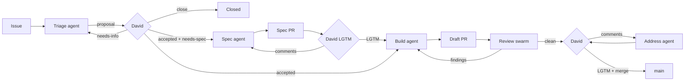

# Software factory

Status: design, under review. Nothing here is built yet.

## Problem and goals

Kaos is developed by Claude agents and reviewed by David, but the loop
runs by hand: David files an issue, asks a session to implement it, asks
again for an agent review, and checks the PR himself, screenshots and
manual testing included. The conventions exist (`[claude]` and
`[claude-review]` comment prefixes, the `ready`/`in-progress`/
`in-review` labels, the `issue-screenshots` branch) but nothing applies
them, and some live only in one user's local memory.

The factory turns this into a pipeline with GitHub as its only state:

1. Every piece of work starts as a GitHub issue.
2. Every issue is triaged.
3. An accepted issue is spec'ed first when it needs one, implemented
   right away otherwise.
4. Every PR is reviewed by several agents, each from one angle (code,
   tests, rules, API, UX, Kafka semantics).
5. David has the final word: he accepts issues, approves specs and is
   the only one who merges.
6. Every PR carries a description, screenshots when it touches the UI,
   and a one-command way to try it.

Non-goals: auto-merge, deployment, a queue service or a custom
orchestrator. The factory is stock Claude Code (skills, subagents,
hooks) plus a few shell scripts.

## Overview



Three human gates, all David's: acceptance at triage, the spec LGTM and
the merge. Everything between them is automatic, but each stage stops
at a gate rather than guessing.

## State: labels and comments

GitHub is the only state. A stage reads the issue, its labels and its
comments, does its work, writes a structured comment, moves the labels
and stops. Any session can pick up any issue.

### Labels

Two flags record David's decisions and never move:

- `accepted`: David accepted the work. **Only David adds it.**
- `needs-spec`: a spec must be approved before the build. The triage
  proposes it, David keeps or drops it, the spec agent removes it after
  the LGTM.

The stage is a separate label, and an open issue has **exactly one**:

| Stage | Meaning |
|---|---|
| `needs-triage` | Not looked at yet |
| `triaged` | Triage proposal posted, waiting for David |
| `needs-info` | Waiting for the reporter |
| `queued` | Accepted, waiting for a spec or build agent |
| `spec-review` | Spec PR open |
| `in-progress` | An agent is implementing or addressing comments |
| `in-review` | PR ready, waiting for David |
| `changes-requested` | David left comments, not picked up yet |
| `blocked` | Waiting on a decision, see the last `[claude]` comment |

Transitions, all applied by the factory unless stated (an arrow swaps
the old stage label for the new one):

| From | Event | To |
|---|---|---|
| none | issue opened, or any open issue without a stage label | `needs-triage` |
| `needs-triage` | triage done | `triaged`, or `needs-info` |
| `needs-info` | a new comment from the reporter or David | `needs-triage` |
| `triaged` | David adds `accepted` | `queued` |
| `triaged` | a new comment from David, no `accepted` | `needs-triage` |
| `queued` + `needs-spec` | spec agent claims it | `spec-review` |
| `spec-review` | David's LGTM, threads resolved | `queued`, `needs-spec` removed |
| `queued`, no `needs-spec` | build agent claims it | `in-progress` |
| `in-progress` | swarm done, PR ready for review | `in-review` |
| `in-review` | a new comment or unresolved thread from David | `changes-requested` |
| `changes-requested` | address agent claims it | `in-progress` |
| any | an agent cannot go on | `blocked` |
| `blocked` | a new comment from David | the stage named in the blocking comment |
| `in-review` | David merges | closed by `Closes #N` |

"New comment from David" means a comment without a prefix, newer than
the last prefixed comment on the issue or PR: the last `[claude…]`
comment is the watermark, no other state is needed. The control room
reports any issue that breaks the one-stage invariant.

Type labels stay (`bug`, `enhancement`, `task`, `documentation`).
New area labels drive the reviewer selection: `area:core`,
`area:server`, `area:api`, `area:ui`, `area:build`, `area:protocol`,
`area:factory`. `priority:high` lets David jump the queue; otherwise
the oldest `queued` issue goes first.

Since every action is taken as `dajac`, GitHub cannot tell David's
labels from Claude's: the guard hook (below) refuses any command run
by Claude that adds `accepted`.

#### Migration

The existing `ready` label is removed rather than renamed: the eight
issues that carry it (#61, #63, #70, #72–#76) were never triaged, and
a rename would make them buildable at once. They go to `needs-triage`
and David re-accepts them on the proposals. The descriptions of
`in-progress`, `in-review`, `blocked` and `changes-requested` are
updated to the meanings above.

#### Claims

A label is not a lock: a manual `/factory build N` can race a tick. An
agent claims an issue by posting a `[claude] Claim` comment with its
session id and time, then re-reads the comments: the oldest open claim
wins and the loser stops. A working agent refreshes its claim (edits
the comment's time) at every step. A claim older than two hours
without a refresh is stale: the tick moves the issue to `blocked` and
tells David, who decides whether to resume or restart it from the
worktree.

### Comments

Claude posts as `dajac`, so every comment it writes starts with a
prefix, which is also how the factory finds David's comments (no
prefix):

- `[claude-triage]` triage proposal
- `[claude]` build, spec and address agents
- `[claude-review:<angle>]` reviewers, for example `[claude-review:ux]`

Handoff comments end with a fenced `yaml` block that the next stage
parses rather than re-reading prose:

````
```yaml
factory:
  stage: triage
  type: bug
  areas: [ui]
  route: build          # build | spec | needs-info | close
  size: s               # s | m | l
  acceptance:
    - The ellipsis is "…" in both "Starting…" and "Stopping…"
  files: [kaos-ui/src/components/Toolbar.tsx]
```
````

## Stages

### 1. Issue intake

Issue forms in `.github/ISSUE_TEMPLATE/` (`bug.yml`, `feature.yml`,
`task.yml`) ask for the problem, the repro or motivation, the expected
behavior and the scope, and apply `needs-triage`. Blank issues stay
allowed for David; they have no label, so the tick gives them
`needs-triage`, and the triage agent fills the gaps.

UI issues carry annotated screenshots on the orphan `issue-screenshots`
branch, as today (`gh` cannot upload attachments to a private repo).

### 2. Triage

`/factory triage [N]`, or every new `needs-triage` issue on a tick. The
agent:

- reproduces the bug when it can (build, run, `GET
  /api/v1/simulator/snapshot`) and says whether it did;
- finds duplicates and related issues and PRs;
- locates the code and the part of `docs/ARCHITECTURE.md` involved;
- proposes the type, areas, size, route and acceptance criteria;
- posts one `[claude-triage]` comment, swaps `needs-triage` for
  `triaged`.

Route rules, which David can override:

- **spec** when the issue changes the public Java API, the HTTP API or
  its JSON, the UX of a whole view, the architecture, or the factory
  itself; when it spans several PRs; or when the triage found two
  reasonable designs and cannot pick one.
- **build** otherwise: bugs with a clear expected behavior, small UI
  fixes, tasks, docs.
- **needs-info** when the expected behavior cannot be inferred.
- **close** for duplicates and things already fixed, proposed only.

The triage agent never closes an issue and never adds `accepted`.
David answers by adding `accepted` (and keeping or removing
`needs-spec`), by commenting, or by closing. A comment from David
without `accepted` sends the issue back to triage on the next tick,
which revises the proposal.

### 3. Spec

For an accepted issue with `needs-spec`. `/factory spec N`:

- branch `spec/<N>-<slug>` from `main`, in its own worktree, adding
  `docs/specs/<N>-<slug>.md`: problem, proposed behavior, API and JSON
  changes, UX (mockups or screenshots of a throwaway prototype for UI
  work), alternatives, impact on `docs/ARCHITECTURE.md`, test strategy
  and, when it spans several PRs, the planned PR stack;
- open the spec PR (`Spec: <title>`, body `Spec for #N`), label the
  issue `spec-review`;
- address David's inline comments with the same loop as code;
- on David's LGTM with every thread resolved: remove `needs-spec`,
  move the issue from `spec-review` to `queued`, comment the spec link,
  close the spec PR. The branch stays until the issue is closed;
  `merge.sh` deletes it with the last implementation PR.

Specs are not merged: `docs/ARCHITECTURE.md` describes the merged code,
and the implementation PR updates it. A spec that turns out wrong
during the build goes back to David (comment on the spec PR, `blocked`
on the issue) instead of being quietly diverged from.

### 4. Build

`/factory build N`, or `/factory next` (the oldest `queued` issue
without `needs-spec`, after `priority:high`). The agent:

1. Claims the issue (`in-progress`, the claim comment), creates the
   worktree `.claude/worktrees/<N>-<slug>` on branch `<N>-<slug>` from
   `main`.
2. For a bug, writes a test that fails on `main` first.
3. Implements, following `CLAUDE.md` and the spec; updates
   `docs/ARCHITECTURE.md` in the same PR.
4. Runs `scripts/factory/gates.sh` (below) until it is green, with at
   most three fix attempts per failing step. A test that also fails on
   `main`, or passes on a rerun without a change, is a flake: the agent
   files it as its own issue, says so in the PR, and goes on.
   Otherwise the issue goes to `blocked`.
5. When the diff touches `kaos-ui/`, captures the screenshots (below),
   whatever the triage areas said.
6. Opens a **draft** PR with the body below and hands it to the review
   swarm. The issue stays `in-progress` until the swarm is done.

#### Stacked PRs

When the spec plans a stack, the spec's PR list becomes a checklist on
the issue. Each PR branches from its parent, has the parent's branch
as base, and says `Part of #N`; only the last one says `Closes #N`.
The issue stays `in-progress` while PRs remain, and the build agent
starts the next one once the previous is ready for review. When David
merges a PR of a stack, `merge.sh` rebases its child onto `main`
(`git rebase --onto main <parent> <child>`), retargets the child PR to
`main` and force-pushes it; the gates rerun on the next tick.

The PR is a draft until the swarm is done: draft means "agents'
turn", ready for review means "David's turn".

#### PR body

The part above the `---` rule is the squash commit message (the usual
title and body rules); the part below is review material that
`scripts/factory/merge.sh` drops at merge.

```markdown
<context, what the change does, optional "Changes:" list>

Closes #N

---

## How to test

    scripts/factory/try-pr.sh 81

Then:
1. Open http://localhost:<port>/ (printed by the script).
2. Freeze consumer-0 and wait one minute.
3. Expected: the badge and "Actions" stay readable over the full cell.

## Screenshots

| Before (`main`) | After |
|---|---|
|  |  |

## Checks

- `scripts/factory/gates.sh full`: PASS (log excerpt)
- New tests: `RowStripTest` fails on `main`, passes here.

## Decisions for David

- …anything the agent decided that the issue or spec did not.
```

#### Gates

`scripts/factory/gates.sh [quick|full]` runs the checks and ends with
one verdict line, `GATES: PASS`, `GATES: FAIL <step>` or
`GATES: MISCONFIGURED <why>` (Docker missing, Node too old). Agents
quote that line; a skipped step can never read as a pass.

- `quick`: `./mvnw spotless:apply`, then `./mvnw verify -DskipITs`.
- `full`: `./mvnw verify` (integration tests, needs Docker). Required
  before a PR leaves draft.

CI keeps running `./mvnw verify` on every PR; the build agent waits
for it to be green, for at most 30 minutes, before handing over to
David. A red or timed-out CI follows the same flake rule as the local
gates.

#### Screenshots and "try it"

Both rest on one script, `scripts/factory/try-pr.sh <PR|branch>
[--scenario <file>]`:

1. creates or reuses a worktree for the branch and builds the shaded
   jar (`-DskipTests`);
2. starts its own `apache/kafka:4.3.1` container on a free port, so
   that parallel runs (David trying a PR while the UX reviewer runs
   another) never share topics or groups; `--bootstrap-server` reuses
   an existing broker instead;
3. runs the server with `--port 0` and a free proxy port and, with
   `--scenario`, drives it to a known state through the HTTP API
   (create the topic, start the group, freeze a consumer...);
4. prints the URL and stops everything, the container included, on
   Ctrl-C or with `--stop`.

Scenarios are small JSON files under `scripts/factory/scenarios/`
(a list of HTTP calls and waits), so David, the build agent and the UX
reviewer see the same state.

Screenshots use Playwright, as a dev dependency of `kaos-ui`, never
shipped in the jar. A PR adds or reuses a capture script under
`kaos-ui/e2e/` that loads a scenario, performs the interactions
(hover, open a menu) and saves PNGs. The build agent runs it twice,
against `main` and against the branch, commits the images to the
`issue-screenshots` branch under `pr-<N>/` and links them in the
body. Each PR writes only its own directory, so concurrent pushes to
that branch are retried after a fetch and rebase, which never
conflicts. Light and dark themes are both captured when the change
affects colors.

### 5. Review swarm

`/factory review N`, started by the orchestrator once the build agent
has opened the draft (a subagent cannot start subagents, see "Driving
the factory"). The orchestrator picks the reviewers from the changed
paths and runs them in parallel as subagents in
`.claude/agents/reviewer-*.md`.

| Reviewer | When | Looks at |
|---|---|---|
| `code` | always | correctness, edge cases, concurrency and shutdown, error paths, simplicity, reuse |
| `tests` | always | the new test fails without the change (it reverts the fix to check), coverage of the acceptance criteria, flakiness (sleeps, ports, timing) |
| `rules` | always | `CLAUDE.md` rules (public vs `internal`, no kafka-clients type in the API or JSON, no static mutable state, the single `ThreadFactory`, `*Test` names, `@IntegrationTest`, `var`), `docs/ARCHITECTURE.md` matches the code, PR body complete |
| `api` | public package of `kaos-core`, `kaos-server`, OpenAPI | naming and consistency with the existing API, compatibility, JSON shape, OpenAPI and `schema.d.ts` in sync, error responses |
| `ux` | `kaos-ui` | runs `try-pr.sh` with the scenario and drives the UI with headless Playwright (not the shared Chrome); the rows show the coordinator view (client-local facts only annotate); wording and labels consistent with the rest of the UI; WCAG AA contrast, keyboard focus, states (loading, stale, stopped); the screenshots match what it sees |
| `kafka` | the consumer, group, assignment, proxy and fault code of `kaos-core`, or `area:protocol` | the simulated behavior matches the real group coordinator and clients, checked against the Apache Kafka sources at the tag of the kafka-clients version in the `pom.xml` (KIP-848 and classic protocols, epochs, revocation, static membership) |

Each reviewer is independent: it gets the issue, the spec, the
acceptance criteria and the diff, but not the build agent's reasoning,
and it does not trust the PR body's claims without checking them. It
returns findings with a file, a line, a severity (`blocker`, `major`,
`minor`, `nit`) and a failure scenario.

A final `verifier` agent drops findings it cannot confirm and merges
duplicates. The survivors are posted as one PR review per reviewer,
inline, prefixed `[claude-review:<angle>]`.

The build agent then replies to every thread (`[claude] Fixed in
<sha>` or why not), pushes new commits (no force-push), and only the
reviewers that had findings re-review their threads and the new diff.
At most two rounds. Then the build agent:

- marks the PR ready for review and moves the issue to `in-review`;
- posts a `[claude] Ready for review` comment: the verdict of each
  reviewer, the findings left open with the reason, the "Decisions for
  David", and what David should look at first;
- notifies David.

Blockers left open after two rounds do not reach David as a ready PR:
the PR stays a draft and the issue gets `blocked` with the open
question.

The review guides (what each angle checks, with Kaos examples) live in
`docs/factory/review/<angle>.md`, so they are versioned and shared.
Lessons that today sit in one user's local memory (the coordinator
view, screenshots on UI issues, the independent review) move there.

### 6. David's review and merge

David reviews the ready PR as he does now. A tick sees his new
comments and unresolved threads and moves the issue to
`changes-requested`. The address agent (on the tick, or with
`/factory address N`) claims it (`in-progress`), fixes, replies once
per thread, reruns the gates (and the screenshots if the UI moved),
and pushes. The orchestrator then runs a light review on the new diff
(`code` and `rules`, plus the reviewers of the touched paths), and the
issue goes back to `in-review`. No agent ever resolves a thread.

Approval is David's "LGTM" (not in a prefixed comment) with every
thread resolved. Only David merges, with `scripts/factory/merge.sh N`,
which he runs himself, outside Claude: squash with the part of the
body above `---`, delete the branch (and the spec branch with the last
PR of the issue), remove the worktree, rebase the child of a stacked
PR. `Closes #N` closes the issue.

## Driving the factory

One entry point, the `factory` skill:

| Command | Does |
|---|---|
| `/factory` | Control room: what waits for David first (triage proposals, specs, ready PRs, blocked issues), then what is in flight |
| `/factory triage [N]` | Triage one or all `needs-triage` issues |
| `/factory spec N` | Write or update the spec |
| `/factory build N` / `next` | Implement an accepted issue |
| `/factory review N` | Run the review swarm |
| `/factory address N` | Address David's comments on a PR or a spec |
| `/factory tick` | One pass of everything above that is unblocked |

The session that runs `/factory` is the orchestrator and stays thin.
A subagent cannot start subagents, so the orchestrator starts every
stage agent (triage, spec, build, address) as a subagent, then starts
the reviewers and the verifier itself, and keeps only the `yaml`
handoffs in its own context, never the diffs or the logs.

`/loop /factory tick` runs the factory unattended in a local session.
A tick first runs `scripts/factory/status.sh`, which reads the open
issues and PRs with `gh` and prints one JSON document: the stage of
each issue, David's new comments, stale claims, broken invariants. When
nothing changed since the last tick, the tick ends there, with no
model work. Otherwise it applies the label transitions, triages,
addresses David's new comments, and starts at most one build, subject
to a work-in-progress limit: no new build while two PRs wait for
David. Work that waits for David is the bottleneck, so the factory
does not pile it up.

Local first: the build and the UX review need Docker, a broker and a
browser, which a local session has. Triage needs none of them and can
later move to a scheduled cloud routine or a GitHub Action on
`issues: opened` without changing the stage contract.

## Guardrails

A `PreToolUse` hook, `.claude/hooks/factory-guard.sh`, registered in a
committed `.claude/settings.json`, refuses:

- `gh pr merge`, `scripts/factory/merge.sh`, `git push` to `main`,
  any force-push to `main` or to `issue-screenshots`;
- adding the `accepted` label, through `gh issue edit` or `gh api
  …/labels`;
- `gh issue close`, and the `resolveReviewThread` GraphQL mutation;
- deleting the `issue-screenshots` branch.

It matches these exact subcommands, so `gh pr close` (the spec agent
closing an approved spec PR) and `Closes #N` in a PR body stay
allowed. Hooks are a guardrail, not a security boundary; the skills
state the same rules. Changes to the factory itself (`.claude/`, `scripts/factory/`,
`docs/factory/`, `.github/`) are always routed to a spec and flagged by
the `rules` reviewer.

## Files

```
.claude/settings.json                 hooks, shared permissions
.claude/hooks/factory-guard.sh
.claude/skills/factory/SKILL.md       router and control room
.claude/skills/factory-{triage,spec,build,review,address}/SKILL.md
.claude/agents/reviewer-{code,tests,rules,api,ux,kafka}.md
.claude/agents/review-verifier.md
.github/ISSUE_TEMPLATE/{bug,feature,task}.yml, config.yml
.github/pull_request_template.md
scripts/factory/{status,gates,try-pr,merge}.sh
scripts/factory/scenarios/*.json
kaos-ui/e2e/                          Playwright capture scripts
docs/factory/README.md                the process, for humans
docs/factory/review/<angle>.md        review guides
docs/specs/                           only on spec branches
```

`CLAUDE.md` gets a short "Factory" section pointing to
`docs/factory/README.md`.

`.gitignore` ignores the whole `.claude/` today, so none of the files
above would be committed. It becomes `.claude/*` with exceptions for
`settings.json`, `hooks/`, `skills/` and `agents/`;
`settings.local.json` and `worktrees/` stay ignored.

## Alternatives considered

- **Everything in GitHub Actions** (`claude-code-action` on issue and
  PR events). Event-driven and hands-off, but the runners have no
  browser session for the UX review, every run pays a cold Maven and
  npm build, and it needs an API key in the repo. Kept as a later
  option for triage only.
- **A local job directory as state** (`factory/jobs/<id>/job.json`, as
  in zazencodes' factory). Simple, but invisible on GitHub and tied to
  one machine; issues, labels and PRs already hold the same state.
- **Agent approver that merges low-risk PRs** (zazencodes). Rejected:
  David has the final word on every change.
- **Specs merged under `docs/specs/`**. They would rot next to
  `docs/ARCHITECTURE.md`, which already describes the merged design.
- **A single reviewer agent** (today). Cheaper, but one context mixes
  angles and misses the UX and Kafka-semantics issues found in the
  release review (#54–#75).

## Rollout

Each step is one PR, usable on its own:

1. The labels and their migration, issue forms, PR template,
   `docs/factory/README.md`, the `CLAUDE.md` pointer, the `.gitignore`
   exceptions.
2. `.claude/settings.json`, the guard hook, `gates.sh`, `merge.sh`.
3. `status.sh`, the `factory` and `factory-triage` skills; pilot on
   the open issues.
4. `try-pr.sh`, the scenarios, the Playwright capture; the
   `factory-build` skill.
5. The reviewers, the verifier, the review guides and the
   `factory-review` skill.
6. The `factory-spec` and `factory-address` skills, `/factory tick`.

Pilot candidates: #73 (ellipses, trivial UI), #75 (classic consumer
configs, core bug), #76 (remove the auto-pilot, likely a spec).

## Open questions

1. Should triage proposals for David's own issues, which he often
   files with a clear scope, auto-accept small bugs? This design says
   no: `accepted` is always his.
2. Playwright as a `kaos-ui` dev dependency, or headless Chrome
   driven from a script with no new dependency?
3. Should the part of the PR body below `---` be dropped at merge? It
   changes the current style: the "Checks" section of #53 landed in
   the commit.
4. `accepted` plus a stage label, or keep `ready` as the name of the
   flag (the migration is the same)?
5. The `kafka` reviewer runs only on the consumer, group, proxy and
   fault paths of `kaos-core`. Is that the right scope?
