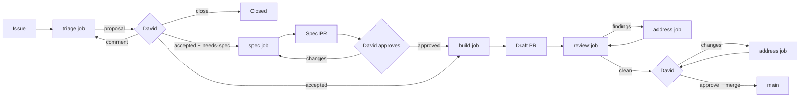

# Software factory

How an issue of Kaos becomes a merged PR. Like `docs/ARCHITECTURE.md`,
this document describes what is merged: the parts not built yet are
marked **planned**, and the marker goes when the part lands. The
design was reviewed in #77.

## Problem and goals

Kaos is developed by Claude agents and reviewed by David, but the loop
runs by hand: David files an issue, asks a session to implement it, asks
again for an agent review, and checks the PR himself, screenshots and
manual testing included. The conventions exist (`[claude]` and
`[claude-review]` comment prefixes, the `ready`/`in-progress`/
`in-review` labels, the `issue-screenshots` branch) but nothing applies
them, some live only in one user's local memory, and every agent action
shows up on GitHub as David's.

The factory turns this into a pipeline with GitHub as its only state:

1. Every piece of work starts as a GitHub issue.
2. Every issue is triaged.
3. An accepted issue is spec'ed first when it needs one, implemented
   right away otherwise.
4. Every PR is reviewed by several agents, each from one angle (code,
   tests, rules, API, UX, Kafka semantics).
5. David has the final word: he accepts issues, approves specs and PRs,
   and is the only one who merges.
6. Every PR carries a description, screenshots when it touches the UI,
   and a one-command way to try it.

And, for David:

7. One command starts and stops the factory.
8. One orchestrator decides what runs.
9. David can see the whole pipeline and what waits for him.
10. The factory acts as its own GitHub identity, a bot, never as David.

Non-goals: auto-merge, deployment, a hosted service.

## Overview



Three human gates, all David's: acceptance at triage, the spec approval
and the PR approval with the merge. Everything between them is
automatic, but each job stops at a gate rather than guessing.

## Architecture

The factory is skills first: what the agents do is a set of Claude
Code skills and subagents, and the plumbing that runs them is a few
bash scripts around `gh`, `jq`, `git` and `openssl`. There is no
program to build and no runtime beyond what the repository already
needs.

Three pieces:

- **The loop**, `./factory up`, a bash script. It holds a lock, so
  there is a single orchestrator, and every two minutes it:
  1. refreshes the trusted checkout (`scripts/factory/trusted.sh`,
     `.claude/worktrees/factory-main` detached at `origin/main`), whose
     scripts, hooks and settings the ticks and jobs use;
  2. runs `scripts/factory/status.sh`, which reads the open issues and
     PRs with `gh` and prints one JSON snapshot: stages, flags, PRs,
     CI, the newest activity per issue;
  3. when the snapshot differs from the previous one, a job just
     ended, David queued a request, or 30 minutes went by, runs one
     **tick**;
  4. runs the job the tick chose, if any, and waits for it.
- **The tick**, `claude -p "/factory-tick"`, a short headless session
  and the brain of the orchestrator (`.claude/skills/factory-tick/`).
  It gets the snapshot, the previous tick's snapshot, the last job's
  status and David's requests; reads what it needs about each issue
  with `scripts/factory/activity.sh <N>` (the last handoff and its
  fields, what David and others wrote since, who added `accepted`,
  when each label was added, the issue's PRs with their CI, David's
  last review and the unresolved threads); applies the transitions of
  the tables below; and returns the next job as structured output
  (`--json-schema scripts/factory/tick-schema.json`: `{job, issue,
  transitions, notes}`). It changes stages only through
  `scripts/factory/stage.sh <N> <to>`, which knows the legal
  transitions and David's gates and refuses anything else, so a
  mistaken tick cannot jump a gate. Each tick starts from a fresh
  context: nothing accumulates from one issue to the next. It also
  removes the local worktrees and branches of merged PRs
  (`scripts/factory/cleanup.sh`).
- **Jobs**, one per piece of model work: `triage`, `spec`, `build`,
  `review` and `address`. A job is a skill run headless by
  `scripts/factory/job.sh <kind> <N>` (`claude -p "/factory-<kind>
  <N>"`) in the issue's worktree. It does its work, posts its result
  on GitHub with a `yaml` handoff block, and exits. It never changes a
  stage label; the next tick reads the handoff and moves the stage.

```
 ./factory up (bash loop, lock)
   │ every 2 min
   ├─► status.sh ──► snapshot changed? ──no──► sleep
   │                      │yes
   ├─► claude -p /factory-tick ──► stage.sh (labels) ──► {job: build, issue: 75}
   └─► job.sh build 75 ──► claude -p /factory-build 75 (worktree 75-…)
              all GitHub calls as kaos-agent[bot]
```

Each job runs in a worktree under `.claude/worktrees/`, which
`job.sh` prepares:

| Job | Worktree |
|---|---|
| `triage` | `triage-<N>`, detached at `main`, removed afterwards |
| `spec` | `spec-<N>-<slug>` on branch `spec/<N>-<slug>` |
| `build`, `address` | `<N>-<slug>` on branch `<N>-<slug>`, kept until the merge |
| `review` | `review-<N>`, detached at the PR head, removed afterwards, so that the `tests` reviewer can revert the fix without touching the author's worktree |

Why this shape:

- **One orchestrator.** The lock (`.factory/lock`, with the loop's
  pid) makes a second `./factory up` refuse to start. Jobs that David
  asks for by hand (`./factory run build 75`) are queued in
  `.factory/requests/` and run by the loop, so two jobs never race for
  one issue and no claim protocol is needed.
- **One job at a time.** The loop waits for each job. Nothing needs
  supervising, and David's review is the bottleneck anyway. A long
  build delays the next triage by its length; if that starts to hurt,
  the loop can run jobs in the background later without changing the
  skills.
- **Review is its own job.** It starts from a fresh context and a
  fresh checkout, with no access to the build job's reasoning, which
  keeps the reviewers independent of the author. It fans out to the
  reviewer subagents itself.
- **Idle polls are free.** `status.sh` is plain `gh` and `jq`; a tick,
  and its model cost, only happens when something changed.

The loop keeps a little local runtime state in `.factory/`
(gitignored): the lock, the last snapshot, the running job (kind,
issue, start time, log path), the request queue, the job logs and the
current bot token. GitHub stays the truth: after a crash or a reboot,
the next tick rebuilds everything from the labels, the PRs and the
timeline: a job that handed off while the loop was down has its handoff
applied, and one that died without a handoff is run again (a job that
the loop saw end without a handoff blocks its issue instead).

Below, "the orchestrator" means the loop and its ticks together.

### Limits

- One job at a time.
- No new `build` while two PRs wait for David, so the factory does not
  pile work up in front of him.
- Each session has a time limit and a budget cap passed to
  `claude -p --max-budget-usd`, both enforced by `job.sh` and
  overridable with `FACTORY_LIMIT_MINUTES` and `FACTORY_BUDGET_USD`:
  tick 10 minutes and $1, triage 30 and $3, spec 45 and $8, build 90
  and $20, review 60 and $20, address 60 and $12. A job that hits
  one is stopped (interrupt, then terminate, then kill), and the next
  tick blocks its issue, naming the job's log in `.factory/logs/`.
- After a failed job, the next tick waits for the next poll, so that a
  job failing at start cannot spin; the tick then blocks the issue
  rather than retrying.

### Permissions of a job

Headless sessions cannot ask for permission. Without a mode, a `-p`
run can start in `auto`, so `job.sh` (and the loop, for the tick)
always passes one:

    claude -p "/factory-build 75" \
      --permission-mode dontAsk --permission-prompts none \
      --settings .claude/worktrees/factory-main/.claude/factory-job.json \
      --max-budget-usd <cap> --output-format stream-json --verbose

The tick also gets `--json-schema` and `--disallowedTools` rules that
deny it any edit outside `.factory/` of the trusted checkout, where it
runs: it reads text anyone can write and sits next to the scripts that
guard it. `job.sh` reverts and reports any other change it finds after
the tick.

- `dontAsk` denies every call that no allow rule covers, and
  `--permission-prompts none` tells Claude not to retry a denied call.
  A job that needs something not allowed fails cleanly, and its issue
  goes to `blocked`; it never hangs on a prompt.
- `.claude/factory-job.json` holds the allowlist, the deny rules,
  `"disableAllHooks": false`, and the `SessionStart` and guard hooks
  (see "Guardrails"). It is read from the trusted checkout
  (`.claude/worktrees/factory-main`, kept at `origin/main` by the loop),
  not from the job's worktree, and finds the hooks through
  `$FACTORY_TRUSTED`, which `job.sh` exports. Both hooks have
  `"onFailure": "block"`: a hook that cannot run blocks the command
  rather than letting it through without the bot's identity.
  - Allowed: reads anywhere but the credentials (`~/.config/gh`,
    `~/.ssh`, `~/.netrc`, `~/.git-credentials` are denied), edits and
    writes under the job's worktree only (`Edit(./**)`), subagents,
    skills, and Bash for `git`, `gh`, `./mvnw`, `npm`, `curl`, `jq`,
    `java`, the read-only `docker` commands, the factory scripts of the
    worktree, and the usual file tools. Not allowed: `node`, `npx`,
    `docker run`, and a bare `Bash`, `Edit` or `Write`.
  - In `dontAsk`, a compound command runs only when each part is
    allowed, and Claude Code refuses `cd` inside a compound, `$(...)`
    in an assignment, and `for` loops: the job skills use `git -C`,
    paths and one command per call instead. A job does not write a
    script to run it: the guard checks the commands it sees, not the
    contents of a file.
  - The project settings of the job's worktree still load, with their
    hooks: Claude Code drops their allow rules in `-p` runs, but a
    project hook could answer "allow". `--setting-sources user` would
    exclude them, but also the project's `CLAUDE.md` and skills, and
    keep David's user `CLAUDE.md`, so it is not used. Instead the deny
    rules and the guard refuse `.claude/settings.local.json`, and
    `job.sh` refuses to start a job whose worktree has one.
    A branch that changes `.claude/settings.json` is factory work,
    which goes through a spec and David's review.
- The `stream-json` log, `.factory/logs/<N>-<kind>.jsonl`, is what
  `./factory logs` follows and what the `blocked` comment quotes.

## Running it

One script at the root of the repository, `./factory`. Everything is
built but `up --at-login` (planned).

| Command | Does |
|---|---|
| `./factory setup` | One-time: checks `claude`, `gh`, `jq`, Docker and Chrome, creates the bot and the labels, stores the bot key in the macOS Keychain, checks that every GitHub action comes out as the bot. Safe to run again |
| `./factory whoami` | Checks the bot's identity, as `setup` does |
| `./factory up` | Starts the loop in the background, logging to `.factory/logs/loop.log`; `--foreground` to watch it |
| `./factory down` | Stops the loop; the running job finishes, or `--now` stops it |
| `./factory status` | The pipeline in the terminal: what waits for David, the running job, blocked issues |
| `./factory logs [N]` | Follows the loop log, or the text and tool calls of the last job of issue N |
| `./factory run <kind> <N>` | Queues one job for the next tick, e.g. `./factory run triage 76`; the tick runs it if the transition is legal |
| `./factory pause` / `resume` | Stop or restart new jobs without stopping the loop |
| `./factory try <PR> [--scenario <name>]` | Builds and runs the PR on its own broker, in the state of a scenario (see "Try it") |
| `./factory merge <PR>` | David's merge, in his own terminal (see stage 6) |

`./factory up --at-login` (planned) installs a launchd agent instead, so the
loop survives reboots. launchd does not inherit the shell's `PATH`,
so `setup` records the absolute paths of `claude`, `gh`, `jq` and
`docker`, and runs a dry tick under launchd to check that the Keychain
items can be read without a prompt. Inside an interactive Claude Code
session, `/factory` prints the same status and can queue a job.

Local first: builds and UX reviews need Docker, a broker and a browser,
which David's machine has. Since the loop and the jobs only talk to
GitHub, they can later move to a server without changing the skills.

## Identity: the bot

The factory acts as a GitHub App, `kaos-agent`, owned by David and
installed on `dajac/kaos` only. Its comments, reviews, pushes, labels
and PRs show as `kaos-agent[bot]`.

- **Creation:** `./factory setup` runs `scripts/factory/create-app.sh`,
  which creates the App with GitHub's App manifest flow and installs it
  on the repo: David confirms twice in the browser, once to create the
  App and once to install it, choosing "Only select repositories" and
  `kaos`. The private key goes to the macOS Keychain (service
  `kaos-agent-private-key`), the App's ids to `.factory/bot.env`. The
  script is resumable: an App created by an interrupted run is reused.
- **Permissions:** Contents, Issues and Pull requests read and write;
  Checks, Commit statuses and Actions read (to follow CI); Metadata
  read. No administration, nothing outside the repo, and no Workflows
  permission: the bot cannot push a change under `.github/workflows/`.
  Such a change is always factory work, which goes through a spec, and
  the job hands David a patch to push himself.
- **Tokens:** `scripts/factory/token.sh` signs a JWT with `openssl`
  and exchanges it for an installation token, valid one hour. It
  caches the token in `.factory/token` and mints a new one when fewer
  than ten minutes are left. `gh` and `git` call it on every use, so a
  job that outlives one token gets the next.
- **`dajac` is David's only.** Nothing the factory or any Claude
  session does appears under `dajac`: no PR, comment, review, label,
  push or commit. This holds for jobs and for interactive Claude Code
  sessions in the repository alike, so Claude can never fall back to
  David's credentials:
  - All of it is set by `scripts/factory/identity.sh`, sourced into
    the shell. It changes nothing until the bot is installed.
  - `GH_TOKEN` is the bot's installation token, exported before every
    command. When no token can be minted, it is set to an invalid
    value, so `gh` fails rather than falling back to David's login:
    the real `gh` holds David's token in the Keychain and hands it to
    any caller that has no `GH_TOKEN`. `GH_CONFIG_DIR` points to an
    empty directory, and `gh` goes through a wrapper
    (`scripts/factory/bin/gh`) that refreshes the token for scripts
    that outlive one.
  - `git` runs with `credential.helper` reset and replaced by a helper
    that prints the bot token. Otherwise the macOS Keychain helper,
    which holds David's credentials, answers first.
  - The `git@github.com:` remotes are rewritten to HTTPS, and
    `GIT_SSH_COMMAND` refuses to run, so David's SSH key is never used.
    A `pushInsteadOf` of David's that sent pushes back to SSH would
    make them fail, not go out as David.
  - A `pre-push` hook (`scripts/factory/git-hooks/`, through
    `core.hooksPath`) refuses any commit not yet on the remote that is
    not authored and committed by the bot: a rebase, a cherry-pick or
    `--author` keeps the original author.
  - `git` author and committer are the bot
    (`kaos-agent[bot] <<app-user-id>+kaos-agent[bot]@users.noreply.github.com>`),
    through `GIT_AUTHOR_*` and `GIT_COMMITTER_*`, so the local
    `user.name` (David) is never used.
  - Every Claude session in the repository gets this environment from
    the `SessionStart` hook of the committed `.claude/settings.json`
    (`.claude/hooks/session-identity.sh`), which writes a line sourcing
    the main checkout's `identity.sh` to `CLAUDE_ENV_FILE`: Claude Code
    runs it before every Bash command. Jobs and ticks get it the same
    way, from the `SessionStart` hook of `factory-job.json`.
  - The guard hook (`.claude/hooks/factory-guard.sh`, see
    "Guardrails") refuses the commands that would undo it: setting
    `GH_TOKEN`, `GIT_CONFIG_*`, `GIT_AUTHOR_*` or `PATH`, `unset` or
    `env -u`, calling another `gh` by its path, `gh auth`, `git -c` or
    `git config` on credentials, URLs, hooks or identity, `--author`,
    `--no-verify`, and `ssh`.
  - `./factory setup` and `./factory whoami` check it in that
    environment: the bot's installation covers `dajac/kaos` only, `git
    credential fill` returns the bot's token and runs no other helper,
    `origin` is read and dry-run pushed over HTTPS, and commits would
    be authored and committed by the bot.

  David's own terminal, outside Claude, keeps his login: his merges,
  approvals and comments are his.
- **Commits** are authored by the bot, with
  `Co-Authored-By: Claude <model> <noreply@anthropic.com>` naming the
  model the job ran on. When the factory's own PRs were merged (by the
  bot), GitHub authored each squash commit with the PR's author: the
  bot for the PRs it opened, David for those opened under his handle
  during the bootstrap. So the squash of a PR the bot opened is the
  bot's; `./factory merge` keeps the `Co-Authored-By` lines of the PR's
  commits. (The factory's own first PRs, opened under David's handle
  during the bootstrap, are authored by David.)

What the bot makes simpler:

- **No more comment prefixes.** The author tells David's comments
  from the factory's. Reviewer comments start with their angle in
  bold, e.g. **UX review**, for readability only.
- **David's gates can be checked.** `accepted` counts only when the
  issue timeline shows David (`dajac`) adding it. If the bot adds it,
  the orchestrator removes it and flags the issue.
- **Real approvals.** David can review a bot PR on GitHub. "Approve"
  replaces the "LGTM" comment and "Request changes" sends it back,
  for specs and code alike.
- **Notifications.** The factory requests David's review when a PR is
  ready, so it lands in his GitHub review queue and inbox. Before,
  his own actions did not notify him.

What it does not fix: on GitHub Free, private repositories have no
branch protection or rulesets, for personal accounts and free
organizations alike. The App needs Contents write to push branches, so
it could also merge or push to `main`. The guard hook and the deny
rules are the barrier, and the orchestrator detects a breach after the
fact (planned): on every poll it checks that each new commit on `main` comes
from a PR merged by David. If one does not, it stops starting jobs,
kills the running ones and alerts David. GitHub Pro would allow a
ruleset on `main` that closes the hole server side; it is left out for
now and can be added later without changing the design.

## The overview

The labels are the state, so GitHub's own views show the pipeline:

- the labels as saved issue searches: `is:open label:triaged` (triage
  proposals to accept), `label:in-review` (PRs ready for David),
  `label:blocked`, `label:queued`...;
- David's review queue, `github.com/pulls/review-requested`, since the
  bot requests his review on every ready PR and spec.

`./factory status` (`scripts/factory/overview.sh`) prints the whole
pipeline in the terminal, from a snapshot, with no model: what waits
for David, what is in flight (with the running job), what is queued,
what waits for triage or information, and the issues with several stage
labels.

```markdown
Updated 2026-10-16 09:14 UTC · loop up · running: review #73 · paused: no

## Waiting for David (3)
| Issue | What | PRs | Since |
|---|---|---|---|
| #81 Row text unreadable | PR ready for review | #90, CI pass | Oct 16 07:10 |
...
```

A page on GitHub was tried and dropped: a pinned issue whose body the
bot rewrote read as a stray issue, and a GitHub Projects board needs
either an organization or David's own token, which the factory never
uses (see "Identity").

## State: labels and handoffs

### Labels

Two flags record David's decisions and never move:

- `accepted`: David accepted the work. **Only David adds it**, and the
  orchestrator checks this against the timeline.
- `needs-spec`: a spec must be approved before the build. The triage
  proposes it, David keeps or drops it, and the orchestrator removes it
  once David approves the spec.

The stage is a separate label, and an open issue has **exactly one**:

| Stage | Meaning | `./factory status` section |
|---|---|---|
| `needs-triage` | Not looked at yet | To triage |
| `triaged` | Proposal posted, waiting for David | Waiting for David |
| `needs-info` | Waiting for the reporter | Needs info |
| `queued` | Accepted, waiting for a job | Queued |
| `spec-review` | Spec PR open | Waiting for David |
| `in-progress` | A build or address job is running | In flight |
| `reviewing` | The draft PR is with the agent review | In flight |
| `in-review` | PR ready, waiting for David | Waiting for David |
| `changes-requested` | David asked for changes | In flight |
| `blocked` | Waiting on a decision, see the last bot comment | Waiting for David |

The orchestrator applies every transition (an arrow swaps
the old stage label for the new one):

| From | Event | To |
|---|---|---|
| none | issue opened, or any open issue without a stage label | `needs-triage` |
| `needs-triage` | a `triage` handoff, nothing from David after it | `triaged`, or `needs-info` |
| `needs-triage` | otherwise | start `triage` |
| `needs-info` | a new comment from anyone but the bot | `needs-triage` |
| `triaged` | David adds `accepted` | `queued` |
| `needs-triage` | David has added `accepted` (for example in place of `triaged`), and the triage proposal is there | `queued` |
| `triaged` | a new comment from David, no `accepted` | `needs-triage` |
| `queued` + `needs-spec` | the job is chosen | `spec-review`, start `spec` |
| `spec-review` | no spec PR yet, or David requests changes or comments | start `spec` again |
| `spec-review` | David approves the spec PR on its head | `queued`, `needs-spec` removed, spec PR closed |
| `queued`, no `needs-spec` | the job is chosen, fewer than two PRs wait for David | `in-progress`, start `build` |
| `in-progress` | a `build` or `address` handoff, PR pushed | `reviewing`, start `review` |
| `reviewing` | a `review` handoff with open `blocker` or `major` findings, round 1; or CI red | `in-progress`, start `address` |
| `reviewing` | nothing blocking, but CI has not reported 30 minutes after the review | `blocked` |
| `reviewing` | a `review` handoff with only `minor` and `nit` left, CI green | `in-review`: PR ready, review requested from David |
| `reviewing` | round 2 with an open `blocker` or `major` | `blocked` |
| `in-review` | David requests changes, opens a review thread, or mentions `@kaos-agent` | `changes-requested` |
| `in-review` | CI red | `in-progress`, start `address` |
| `changes-requested` | the job is chosen | `in-progress`, start `address` |
| `in-review` (child of a stack, planned) | the parent PR is merged | `in-progress`, start `address` to rebase onto `main` |
| any | a job fails, times out, ends without a handoff, or reports `blocked` | `blocked` |
| `blocked` | a new comment from David | the stage it was blocked from (`stage.sh` allows nothing else but `needs-triage`) |
| `in-review` | David merges | issue closed by `Closes #N`; the next tick removes the local worktree and branch |
| `in-progress`, `reviewing`, `in-review` | the PR (not a spec PR) is closed without merging | `blocked` |

The table is the summary; the rules the tick applies, with their exact
conditions and their order, are in `.claude/skills/factory-tick/SKILL.md`.
`stage.sh` refuses any transition outside this table.

When several events land in the same poll, David's decisions win, in
this order: closing, `accepted`, then comments. A plain comment on a
ready PR is not a request for changes; David mentions `@kaos-agent`
when he wants an answer or a change without a formal review.

Review rounds are counted in the `review` handoff (`round: 1` or `2`),
and restart at 1 each time David sends the PR back.

A "new" comment is one newer than the `seen_until` time of the last
handoff of a job that reads David's comments (triage, spec, build,
address) or of the tick, the moment its job read GitHub, so a comment posted while a
job runs is not lost behind that job's own comments; a review's
handoff does not move this watermark. The orchestrator
reads issue comments, PR comments, reviews and inline review comments
together. `./factory status` flags any issue that breaks
the one-stage invariant.

Type labels stay (`bug`, `enhancement`, `task`, `documentation`).
New area labels drive the reviewer selection: `area:core`,
`area:server`, `area:api`, `area:ui`, `area:build`, `area:protocol`,
`area:factory`. `priority:high` lets David jump the queue. Otherwise
the oldest `queued` issue goes first.

#### Migration

The existing `ready` label is removed rather than renamed. The eight
issues that carry it (#61, #63, #70, #72–#76) were never triaged, and
a rename would make them buildable at once. They go to `needs-triage`
and David re-accepts them from the proposals. `in-progress`,
`in-review`, `blocked` and `changes-requested` keep their names, with
new descriptions.

### Handoffs

A job ends with one comment whose last part is a fenced `yaml` block.
The orchestrator parses it to move the stage, so the next job does not
have to re-read prose:

````
```yaml
factory:
  job: triage
  type: bug
  areas: [ui]
  route: build          # build | spec | needs-info | close
  size: s               # s | m | l
  acceptance:
    - The ellipsis is "…" in both "Starting…" and "Stopping…"
  files: [kaos-ui/src/components/Toolbar.tsx]
  seen_until: 2026-10-16T09:12:44Z
```
````

A job that ends without a valid handoff counts as failed.

## Jobs

### 1. Issue intake

Issue forms in `.github/ISSUE_TEMPLATE/` (`bug.yml`, `feature.yml`,
`task.yml`) ask for the problem, the repro or motivation, the expected
behavior and the scope. Blank issues stay allowed for David; the
orchestrator gives every unlabeled issue `needs-triage`.

UI issues carry annotated screenshots on the orphan `issue-screenshots`
branch, as today. `gh` cannot upload attachments to a private repo.

### 2. `triage`

The job:

- reproduces the bug when it can (build, run, `GET
  /api/v1/simulator/snapshot`) and says whether it did;
- finds duplicates and related issues and PRs;
- locates the code and the part of `docs/ARCHITECTURE.md` involved;
- proposes the type, areas, size, route and acceptance criteria, and
  applies the type and area labels;
- posts the proposal with its handoff.

Route rules, which David can override:

- **spec** when the issue changes the public Java API, the HTTP API or
  its JSON, the UX of a whole view, the architecture, or the factory
  itself; when it spans several PRs; or when the triage found two
  reasonable designs and cannot pick one.
- **build** otherwise: bugs with a clear expected behavior, small UI
  fixes, tasks, docs.
- **needs-info** when the expected behavior cannot be inferred.
- **close** for duplicates and things already fixed. This is only a
  proposal; David closes.

David answers in one of three ways:

- He adds `accepted`, keeping `needs-spec` or removing it.
- He comments. The issue goes back to triage, which revises its
  proposal.
- He closes the issue.

### 3. `spec`

`.claude/skills/factory-spec/SKILL.md`. For an accepted issue with
`needs-spec`:

- branch `spec/<N>-<slug>` from `main`, in its own worktree, adding
  `docs/specs/<N>-<slug>.md`. The spec covers:
  - the problem and the proposed behavior;
  - API and JSON changes;
  - the UX, with mockups or screenshots of a throwaway prototype for
    UI work;
  - the alternatives;
  - the impact on `docs/ARCHITECTURE.md`;
  - the test strategy;
  - the open questions for David, each with a recommendation;
  - the planned PR stack, when the work spans several PRs (stacks are
    planned: until then, the spec proposes the smallest first PR that
    is useful on its own);
- opens the spec PR (`Spec: <title>`, body `Spec for #N`) and requests
  David's review;
- on later runs, addresses David's comments with the same rules as the
  `address` job: new commits, one reply per thread, his review
  requested again.

Once David approves it, the orchestrator closes the spec PR. Specs are
not merged, because `docs/ARCHITECTURE.md` describes the merged code
and the implementation PR updates it. The branch stays until the issue
is closed. A spec that turns out wrong during the build goes back to
David: the build job reports `blocked` with the question, rather than
quietly departing from the spec.

### 4. `build`

`.claude/skills/factory-build/SKILL.md`. The loop has created the
worktree `.claude/worktrees/<N>-<slug>` on branch `<N>-<slug>` from
`main`, or continues it when an earlier build pushed it. The job:

1. Reads the issue, the accepted triage and, if any, the approved spec.
2. For a bug, writes a test that fails first, and keeps its failure.
3. Implements, following `CLAUDE.md` and the spec; updates
   `docs/ARCHITECTURE.md` in the same PR; formats and commits.
4. Runs `scripts/factory/gates.sh full` (below) until it is green, with
   at most three fix attempts per failing step. A failing test whose
   class passes twice when run alone, without a change, is a flake: the
   job files it as its own issue, says so in the PR, and goes on.
   Otherwise it reports `blocked`.
5. Adds a scenario when none shows the change, and pushes.
6. Opens a **draft** PR with the body below, or updates the one an
   earlier run opened.
7. When the diff touches `kaos-ui/`, whatever the triage areas said,
   lists the shots, takes them of `main` and of the branch, checks
   them, publishes them, and puts them in the body (below).
8. Hands off with a `build` comment on the issue.

Draft means it is the agents' turn. Ready for review, with David's
review requested, means it is David's turn.

#### Stacked PRs (planned)

When the spec plans a stack, each planned PR becomes a GitHub
sub-issue of the issue, so that every PR has its own issue and its own
stage, and the one-stage invariant holds:

- The sub-issues are created `queued` (and `accepted`, by David's
  approval of the spec) and are built in order: the orchestrator
  queues the next one once the previous is ready for review.
- Each PR branches from its parent, has the parent's branch as base,
  and closes its own sub-issue. The parent issue closes with its last
  sub-issue.
- When a PR of the stack is merged, the orchestrator starts an
  `address` job on its child. The job rebases the child onto `main`
  (`git rebase --onto main <parent> <child>`), reruns the gates and
  force-pushes. The orchestrator then retargets the child PR to `main`.

The spec job proposes the sub-issues; the orchestrator creates them
only after David approves the spec, which counts as his acceptance of
each of them.

#### PR body

The part above the `---` rule is the squash commit message, following
the usual title and body rules. The part below is review material,
which `./factory merge` drops.

```markdown
<context, what the change does, optional "Changes:" list>

Closes #N

---

## How to test

    ./factory try 81

Then:
1. Open the URL the command prints.
2. Freeze consumer-0 and wait one minute.
3. Expected: the badge and "Actions" stay readable over the full cell.

## Screenshots

| Before (`main`) | After |
|---|---|
|  |  |

## Checks

- `scripts/factory/gates.sh full`: PASS (log excerpt)
- New tests: `RowStripTest` fails on `main`, passes here.

## Decisions for David

- …anything the agent decided that the issue or spec did not.
```

#### Gates

`scripts/factory/gates.sh [quick|full]` runs the checks and ends with
one verdict line: `GATES: PASS`, `GATES: FAIL <step>` or
`GATES: MISCONFIGURED <why>` (Docker missing, wrong JDK). Jobs quote
that line, so a skipped step can never read as a pass.

It runs from the root of the worktree it is called in, and checks the
JDK (21 or later, the one of `JAVA_HOME` when set, as `./mvnw` does)
and, for `full`, Docker, before anything else. Then:

- `format`: `./mvnw spotless:check`; it only checks, so that the
  verdict is about the tree the job pushes: a job runs
  `./mvnw spotless:apply` and commits the result first;
- `factory-tests`: `scripts/factory/test/run.sh`;
- `verify`: `./mvnw verify -DskipITs` for `quick`, `./mvnw verify`
  with the integration tests for `full`, which is required before a PR
  leaves draft.

Each step logs to `.factory/logs/gates-<step>.log` in the worktree; a
failing step prints its last 60 lines before the verdict.

CI keeps running `./mvnw verify` on every PR. The orchestrator moves a
PR to `in-review` only once CI is green, and waits at most 30 minutes.
A red or timed-out CI starts an `address` job, which follows the same
flake rule as the local gates.

#### Try it and screenshots

`./factory try <PR|branch|main|.> [--scenario <name>]`
(`scripts/factory/try-pr.sh`) does four things:

1. creates or reuses a worktree `.claude/worktrees/try-<name>` at the
   PR's head, fetched into a ref of its own (`.` runs the current
   worktree as it is), and builds the shaded jar (`-DskipTests`;
   `--no-build` reuses an earlier build of the same head);
2. starts its own `apache/kafka:4.3.1` container on a free port, with
   the KRaft settings of a single node and the port it advertises, so
   that parallel runs never share topics or groups (for example David
   trying one PR while a job takes screenshots of another);
3. runs the server on free ports, checks that the port answering is
   its own server's, and, unless `--scenario none`, drives it to a
   known state through the HTTP API with a scenario, the tree's
   `default.json` unless `--scenario` names another;
4. prints the URL, then stops everything, the container included, on
   Ctrl-C or on any failure: the server first, then its broker, so that
   a dying server never reaches the next run's broker on the same port.
   With `--detach` it returns and `try-pr.sh --stop <name>` stops it.

A run is named after its target, `try-<PR|branch|main>`, or after
`--as <name>`: the build job's shots run as `try-shots-…`, so they
never stop a run of David's. `./factory try --clean` stops every run
and removes the `try-*` worktrees.

Scenarios are small JSON files under `scripts/factory/scenarios/`, run
by `scripts/factory/scenario.sh`: requests, waits on a `jq` filter of a
`GET`, and sleeps, with an optional `include` of another scenario.
The factory's scenarios are the shared ones; a PR's own live with its
screenshots (below). `default.json` makes one topic of 6 partitions, a producer and a group
of 3 consumers, and waits until each consumer owns the partitions the
coordinator targets for it; `frozen-consumer.json` then freezes
`consumer-0` for a minute. David and the build job see the same state.

Screenshots add no dependency and no code to maintain:
`scripts/factory/capture.sh <url> <out.png> [--size WxH] [--wait-ms N]`
uses the local Chrome's own headless screenshot, with a profile of its
own. Chrome takes that shot at the page's load event, before the UI
has received its first snapshot over SSE (its `--virtual-time-budget`
would wait forever on the open stream, and its `--timeout` does not
delay the shot). So Chrome loads a local wrapper page: the UI in a
full-size frame, and a hidden image that a one-shot `nc` server answers
only after `--wait-ms`. The load event, and the shot, wait for it.

A PR holds its change, its tests and its documentation only. What is
made just to show it stays out of it: the build job keeps the list of
shots in `.factory/pr/shots.txt` of its worktree, one per line,
`<name> <scenario> <path> <size>` (the UI has a dark theme only), and a
scenario written for the PR next to it, in `.factory/pr/<name>.json`.
`scripts/factory/shots.sh <tree> <list> <out-dir> <suffix>` takes the
shots for one tree, building it once and running a fresh server per
shot; a scenario comes from the list's directory, or else from the
factory's `scripts/factory/scenarios/`, so that the shots of `main`
show the same state as the PR's.

The limit is that a shot shows a state, not an interaction: hover
states, open menus and keyboard focus cannot be captured. The PR's
"How to test" covers those for David instead. Most Kaos UI issues are
about states (cells, badges, contrast, stale data), so this covers
most of them; a CDP driver can be added later if it does not.

The build job takes the shots twice, of `main` (suffix `before`) and of
its worktree (`after`), checks them, and publishes them with the list
and the PR's scenarios: `scripts/factory/publish-shots.sh <PR>
<file>...`, from a detached worktree of its own
(`.claude/worktrees/factory-screenshots`), commits them to the
`issue-screenshots` branch under `pr-<PR>/` and prints the Markdown
images for the body. `./factory try <PR> --scenario <name>` looks a
scenario up in the PR's tree, then in the factory's, then in `pr-<PR>/`
on that branch. Each PR writes only its own directory, so a push
rejected by a concurrent one is simply retried after a rebase; it
never conflicts.

### 5. `review`

`.claude/skills/factory-review/SKILL.md`. A review job runs on every
draft PR the orchestrator hands it, and again after each `address`
round, in `.claude/worktrees/review-<N>`, a checkout of the PR head
whose `.claude/` and `CLAUDE.md` `job.sh` replaces with main's: Claude
Code loads the agents, skills and instructions of its working
directory, and a PR must not bring its own reviewers. It
picks the reviewers from the changed paths and runs them in parallel
as subagents, each defined in `.claude/agents/reviewer-<angle>.md`:
what the angle checks, the severities, and the JSON it returns.

| Reviewer | When | Looks at |
|---|---|---|
| `code` | always | correctness, edge cases, concurrency and shutdown, error paths, simplicity, reuse |
| `tests` | always | the new test fails without the change (it reverts the fix to check), coverage of the acceptance criteria, flakiness (sleeps, ports, timing) |
| `rules` | always | `CLAUDE.md` rules (public vs `internal`, no kafka-clients type in the API or JSON, no static mutable state, the single `ThreadFactory`, `*Test` names, `@IntegrationTest`, `var`), `docs/ARCHITECTURE.md` matches the code, PR body complete |
| `api` | public package of `kaos-core`, `kaos-server`, OpenAPI | naming and consistency with the existing API, compatibility, JSON shape, OpenAPI and `schema.d.ts` in sync, error responses |
| `ux` | `kaos-ui` | runs the PR with `try-pr.sh` and the scenario and takes its own shots with `capture.sh` (states only, it cannot click); the rows show the coordinator view (client-local facts only annotate); wording and labels consistent with the rest of the UI; WCAG AA contrast, keyboard focus styles in the CSS, states (loading, stale, stopped); the screenshots match what it sees |
| `kafka` | the consumer, group, assignment, proxy and fault code of `kaos-core`, or `area:protocol` | the simulated behavior matches the real group coordinator and clients, checked against the Apache Kafka sources at the tag of the kafka-clients version in the `pom.xml` (KIP-848 and classic protocols, epochs, revocation, static membership) |

Each reviewer is independent. It gets the issue, the spec, the
acceptance criteria, the PR's body and reads the diff, not the build
job's reasoning. Only the tests reviewer (in a worktree of its own) and
the UX reviewer build: the others read the checkout they share. It
does not trust the PR body's claims without checking them. It returns
findings with a file, a line, a severity (`blocker`, `major`, `minor`,
`nit`) and a failure scenario.

A final `review-verifier` subagent checks each finding against the
code, drops the ones it cannot confirm, merges duplicates and lowers
overstated severities. The survivors are posted as one PR review per
angle, with the event `COMMENT` and inline comments (findings on lines
outside the diff go into the review's body). The round is counted from
the issue's handoffs: 1, plus the `review` handoffs since the last
build or David's last request for changes. On round 2, only the angles
that had findings re-review, with their previous findings, the
replies, and the diff since their previous review.

The review job's handoff carries `round`, `blocking` (the `blocker` and
`major` findings still open: kept by the verifier, or earlier ones not
resolved), `minor`, the list of open findings, the angles and the head
it reviewed. Inline comments go only on lines of the diff's hunks; the
others go into the review's body.

The `address` job replies once to each thread it addresses, the agent
reviewers' and David's only (fixed in `<sha>`, or why
not) and pushes new commits, never a force-push.

After at most two rounds the orchestrator either hands the PR to David
or blocks it. `blocker` and `major` findings must be fixed; `minor`
and `nit` may be left open with a reason.

- **No `blocker` or `major` open:** it marks the PR ready for
  review and requests David's review. The review job's last comment
  summarizes it for David:
  - each reviewer's verdict;
  - the findings left open, with the reason;
  - the "Decisions for David";
  - what to look at first.
- **A `blocker` or `major` still open after round 2:** the PR stays a
  draft and the issue goes to `blocked` with the open question.

What each angle checks lives in its agent file, versioned with the
code. Lessons that sat in one user's local memory moved there: the UX
reviewer checks the rows against the coordinator's view, and the review
is independent of the author.

### 6. `address`, David's review and the merge

`.claude/skills/factory-address/SKILL.md` answers whatever stands
between a PR and David's approval: the agent reviewers' findings (from
`reviewing`), a red CI, and David's own review.

David reviews the ready PR on GitHub. "Request changes", a review
thread, or a comment mentioning `@kaos-agent` moves the issue to
`changes-requested`, and an `address` job:

1. fixes;
2. replies once per thread, and never resolves one;
3. reruns the gates, and the screenshots if the UI moved;
4. pushes new commits.

A new `review` round follows, with the reviewers of the touched paths
and the round count restarted, before the PR comes back to David.

Approval is David's GitHub "Approve" with every thread resolved and CI
green. Only David merges, in one of two ways:

- `./factory merge <PR>` (`scripts/factory/merge.sh`), in his own
  terminal. It refuses to run with the bot's identity or with a `gh`
  logged in as anyone else, and merges only a PR that is open, not a
  draft, based on `main`, whose last review by David approves its
  current head, with no unresolved thread and every check green. It
  squashes with the PR title and `(#N)` (once), and the body above
  the `---` rule without its HTML comments, prints the author GitHub
  recorded, retargets the PRs based on its branch to `main`, and
  deletes the branch. (GitHub closes, rather than retargets, a PR whose
  base branch is deleted through its API.) The squash keeps the
  `Co-Authored-By` lines of the PR's commits. GitHub does not let anyone approve their own
  PR, so the bootstrap PRs, opened under David's handle, are merged
  with the button.
- The "Squash and merge" button, after trimming the message himself.

The orchestrator does the rest of the cleanup either way, after it
sees the merge: the next tick removes the local worktree and branch of
a merged bot PR (`scripts/factory/cleanup.sh`, which touches only
`<N>-<slug>` and `spec/<N>-<slug>` branches and keeps a worktree with
uncommitted changes). Deleting
the spec branch with the last PR of the issue and rebasing the child of
a stacked PR are planned.

`Closes #N` closes the issue.

## Guardrails

A `PreToolUse` hook, `.claude/hooks/factory-guard.sh`, refuses these
commands. It is registered in the committed `.claude/settings.json`,
for every session, and again in `.claude/factory-job.json`, which jobs
load from the trusted checkout. It checks each simple command of the line on its own, so
that `git push origin x && git checkout main` is not mistaken for a
push to `main`. The refused commands are:

- `gh pr merge`, `./factory merge`, `git push` to `main`, and any
  force-push to `main` or to `issue-screenshots`;
- adding the `accepted` label, through `gh issue edit` or `gh api
  …/labels`;
- `gh issue close`, the `resolveReviewThread` GraphQL mutation, and
  `gh pr review --approve`;
- deleting the `issue-screenshots` branch;
- adding or removing a stage label by hand: stages change through
  `stage.sh` only;
- once the bot exists, the ways around its identity listed in
  "Identity", reading credentials other than the bot's (`git
  credential`, `security`), git aliases, and `xargs` and `find -exec`,
  which run commands the guard would not see.

A command can run another one (`xargs`, `find -exec`, git and `gh`
aliases), so David's gates and the identity escapes are refused
wherever they appear in the line, not only as a command's first word;
what runs a quoted string as a command (`bash -c`, `eval`) is refused,
since the guard cannot look into it. Quoted strings and heredoc bodies
are data (commit messages, PR bodies, patterns): the line-wide checks
skip them, while the per-command checks see through quotes, so that
`gh pr "merge"` reads as `gh pr merge`; every match ignores case. Its
tests are in `scripts/factory/test/guard_test.sh` and
`guard_data_test.sh`. Hooks are a guardrail, not a security boundary: the job
instructions state the same rules, `factory-job.json` repeats the
plainest forms as deny rules (the guard is the real check: a deny
pattern cannot tell `git push origin main` from every way to write it),
and `stage.sh` checks the `accepted` gate against
the timeline. The jobs' `factory-job.json` and hooks come from the
trusted checkout, which the loop resets to `origin/main` on every poll,
and `job.sh` reverts any change a tick makes there. Changes to the factory itself
(`factory`, `.claude/`, `scripts/factory/`, `docs/factory/`,
`.github/`) always go through a spec, and the `rules` reviewer flags
them. Claude Code loads the hooks, skills, agents and `CLAUDE.md` of a
job's worktree, and the job runs the worktree's scripts, so a branch
that changes `.claude/`, `CLAUDE.md`, `scripts/factory/` or `./factory`
would change the rules of its own jobs: `job.sh` refuses to run a spec,
build or address job on such a branch (measured from where the branch
forked from `main`, so a branch older than a change of main's is not
taken for one), the tick blocks the issue with the reason, and David
builds those changes himself. The review job replaces them with main's
(`git checkout --no-overlay`, which also removes the files a PR adds
there).

Sessions in a worktree whose branch predates the factory (or the frozen
`initial-setup` branch) have no `.claude/settings.json`, hence no guard
and no bot identity: they act as David, as before the factory.

`FACTORY_REF` (default `main`) names the branch the trusted checkout
and the jobs' worktrees start from; it exists to try the factory on its
own branch before it is merged.

## Files

Built:

```
factory                               the CLI (bash)
scripts/factory/lib.sh                helpers shared by the scripts
scripts/factory/create-app.sh         creates and installs the bot
scripts/factory/token.sh              the bot's installation token (openssl + curl)
scripts/factory/identity.sh           the bot's gh, git and author environment
scripts/factory/bin/                  the gh wrapper, the git credential helper, no-ssh
scripts/factory/git-hooks/pre-push    refuses commits not by the bot
scripts/factory/labels.sh             the labels and their migration
scripts/factory/test/                 the tests of the scripts (test/run.sh)
.claude/settings.json                 the SessionStart and guard hooks, for every session
.claude/hooks/session-identity.sh     sources identity.sh before every command
.claude/hooks/factory-guard.sh        the guard
.claude/factory-job.json              settings of the jobs: allowlist, deny rules, hooks
scripts/factory/gates.sh              the checks, with one verdict line
scripts/factory/merge.sh              David's merge
scripts/factory/trusted.sh            the trusted checkout, .claude/worktrees/factory-main
scripts/factory/status.sh             the snapshot (gh + jq)
scripts/factory/activity.sh           what the tick needs about one issue
scripts/factory/stage.sh              legal stage transitions and David's gates
scripts/factory/job.sh                runs one job or tick headless, with limits
scripts/factory/tick-schema.json      the tick's structured output
scripts/factory/overview.sh           the overview of ./factory status
scripts/factory/cleanup.sh            removes the local worktree and branch of a merged PR
.claude/skills/factory/SKILL.md       /factory in an interactive session
.claude/skills/factory-tick/SKILL.md  the transitions and the choice of the next job
.claude/skills/factory-triage/SKILL.md
.claude/skills/factory-build/SKILL.md
.claude/skills/factory-review/SKILL.md
.claude/skills/factory-spec/SKILL.md
.claude/skills/factory-address/SKILL.md
.claude/agents/reviewer-{code,tests,rules,api,ux,kafka}.md
.claude/agents/review-verifier.md
scripts/factory/try-pr.sh             ./factory try: a tree on its own broker, in a scenario's state
scripts/factory/scenario.sh           runs a scenario against a server
scripts/factory/scenarios/*.json      the scenarios
scripts/factory/capture.sh            one headless Chrome screenshot
scripts/factory/shots.sh              the shots a PR lists, for one tree
scripts/factory/publish-shots.sh      the shots, on the issue-screenshots branch
.github/ISSUE_TEMPLATE/{bug,feature,task}.yml, config.yml
.github/pull_request_template.md
docs/factory/README.md                this document
.factory/                             runtime state, gitignored
```

Planned: none. The specs live under `docs/specs/` on their spec branches only.

The scripts need `bash`, `gh`, `jq`, `git`, `openssl`, `curl`, Docker
and Chrome, all already on David's machine; no Node, Python or extra
Java code.

`CLAUDE.md` gets a short "Factory" section pointing to
`docs/factory/README.md`.

`.gitignore` ignores the whole `.claude/` today, so none of the files
above would be committed. It becomes `.claude/*` with exceptions for
`settings.json`, `factory-job.json`, `hooks/`, `skills/` and `agents/`;
`settings.local.json` and `worktrees/` stay ignored. `.factory/` is
added.

## Alternatives considered

- **A program as orchestrator** (Node or Java), with the transitions
  in code, several jobs in parallel, and a CDP driver for interactive
  screenshots. More predictable and parallel, but it is a program to
  write, test and maintain, and a runtime to require. Skills first is
  enough at David's review pace; the loop can become a program later
  without changing the skills, the labels or the handoffs.
- **A long `/loop /factory tick` session.** Its context grows with
  every issue, and it costs model work on every tick. The bash loop
  starts a fresh tick only when something changed.
- **Everything in GitHub Actions** (`claude-code-action` on issue and
  PR events). Event-driven and hands-off, but the runners have no
  browser for the UX review, every run pays a cold Maven and npm
  build, and it needs an API key in the repo. Still possible later for
  triage only, since the job contract is the same.
- **A machine user** (a second GitHub account) instead of an App. It
  could write to a user-owned Projects board and needs no token
  minting, but it is a full account with a long-lived token, counts as
  a collaborator, and its actions look like a person's. The App is the
  real bot, with short-lived tokens scoped to one repo.
- **A GitHub Projects board** synced with David's token. Rejected:
  the factory never acts as `dajac`. Moving the repo to an
  organization would let the App own a board, but the repo stays
  `dajac/kaos`.
- **A local job directory as state** (zazencodes' factory). Invisible
  on GitHub and tied to one machine.
- **An agent approver that merges low-risk PRs** (zazencodes).
  Rejected: David has the final word on every change.
- **A single reviewer agent** (today). Cheaper, but one context mixes
  angles and misses the UX and Kafka-semantics issues found in the
  release review (#54–#75).

## Rollout

Each step is one PR, usable on its own.

Bootstrap exception: until step 1 has created `kaos-agent` and
`./factory setup` has checked its identity, the factory's own PRs
(this design included) are opened, committed and pushed under
`dajac`, as David allowed. From then on, the rule in "Identity"
applies to everything, the remaining rollout steps included.

1. Built. The bot: create the App, `token.sh`, `./factory setup`, the
   identity of every session (`identity.sh`, the `SessionStart` hook)
   and the guard hook; the labels and their migration; issue forms;
   PR template; `docs/factory/README.md`; the `.gitignore` changes and
   the `CLAUDE.md` pointer.
2. Built. `factory-job.json`, `gates.sh`, `./factory merge`.
3. Built. The loop, `status.sh`, `stage.sh`, `activity.sh` and their
   tests, `job.sh`, the trusted checkout, the overview,
   `./factory up/down/status/logs/run/pause/resume`, the `tick` and
   `triage` skills. Pilot on the open issues.
4. Built. `./factory try`, the scenarios, `capture.sh`, `shots.sh`,
   `publish-shots.sh`, the `build` skill, and the commit and PR
   conventions in `CLAUDE.md`.
5. Built. The reviewers, the verifier, and the `review` skill.
6. Built. The `spec` and `address` skills.
7. Stacked PRs with sub-issues: the spec's PR list becomes sub-issues
   that count as accepted through David's approval of the spec, which
   needs a gate of its own in `stage.sh`; the rebase of a child when
   its parent merges; deleting the spec branch with the last PR.

Pilot candidates: #73 (ellipses, trivial UI), #75 (classic consumer
configs, core bug), #76 (remove the auto-pilot, likely a spec).

## Decisions

- David always accepts issues himself, small bugs included.
- The PR body's review material (below `---`) is dropped at merge.
- The bot authors every commit, the squash commit included.
- The bot is the GitHub App `kaos-agent`; `dajac` is never used for
  anything David does not do himself, outside the bootstrap.
- The repository stays `dajac/kaos`, on GitHub Free.
- Skills first: skills and subagents for the behavior, bash for the
  plumbing, no program and no new runtime.
- Screenshots use the local Chrome's headless screenshot, with no new
  dependency; they show states, not interactions.
- The `kafka` reviewer runs only on the `kaos-core` code that
  simulates Kafka.
